# The Day I Made That Promise · PWA

**Arquitectura, implementación y pruebas de la aplicación web progresiva.**

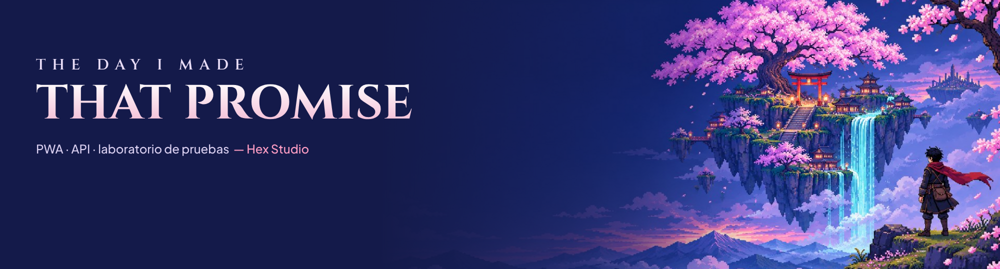

Aplicación web progresiva que presenta el juego, ofrece la descarga de la demo y de la app móvil, administra la cuenta del jugador y muestra su progreso guardado en la nube. Este documento describe su arquitectura, las interfaces entre sus componentes, el consumo de la API, la estrategia PWA, el diseño de la experiencia de usuario y cómo se prueba.

**Equipo Hex Studio:** Jáuregui Iracheta Víctor Yahir · Medellín Salcedo Santiago · Molina Reza Omar Gael · Ramos Juárez Brenda Regina · Rodríguez González Emmanuel · Sidas Rodríguez Pedro Arturo

| | |
|---|---|
| Repositorio | <https://github.com/Sidas200/integradora-web> (rama `main`) |
| Entrega y requisitos | [`SUBMISSION.md`](SUBMISSION.md) |
| Laboratorio de pruebas | [`docs/testing/README.md`](docs/testing/README.md) |
| Script de base de datos | [`docs/db/`](docs/db) (§6) |

---

## Índice

1. [Resumen](#1-resumen)
2. [Alcance](#2-alcance)
3. [Stack tecnológico](#3-stack-tecnológico)
4. [Arquitectura](#4-arquitectura)
5. [Interfaces](#5-interfaces)
6. [Base de datos](#6-base-de-datos)
7. [Consumo de API](#7-consumo-de-api)
8. [Estrategia PWA](#8-estrategia-pwa)
9. [Experiencia de usuario (UI/UX)](#9-experiencia-de-usuario-uiux)
10. [Seguridad y sesiones](#10-seguridad-y-sesiones)
11. [Calidad, pruebas y despliegue](#11-calidad-pruebas-y-despliegue)
12. [Cambios respecto a la propuesta](#12-cambios-respecto-a-la-propuesta)

---

## 1. Resumen

- **Qué es:** una PWA instalable que presenta el juego (historia, galería y personajes), ofrece la descarga de la demo para Windows y de la app para Android, permite crear y administrar la cuenta del jugador y muestra su progreso guardado en la nube (partidas, historial y logros).
- **Clientes de la API:** la PWA, el juego en Unity (PC) y la app móvil en Flutter. Ninguno habla con la base de datos; solo la API (el microservicio *core* del proyecto).
- **Stack:** **React 19 + TypeScript sobre Vite 8** en el frontend, **Spring Boot 4.1 con Java 21** en N-capas en el backend y **PostgreSQL** (Supabase) como base de datos.
- **Consumo de API:** listas paginadas que se piden con un cliente tipado desde el contrato OpenAPI, se guardan en caché y se pintan con cuatro estados (cargando, error, vacía, con datos).
- **Estrategia PWA:** manifiesto con íconos *maskable*, atajos y capturas; Service Worker propio (Workbox) con precache, caché de la API pública, cola en segundo plano (*Background Sync*) y actualización controlada por el usuario; datos del jugador disponibles sin conexión en modo lectura.
- **UI/UX:** módulos por funcionalidad en TypeScript, CSS Modules con tokens de diseño, tema claro y oscuro y diseño adaptativo *mobile first*.
- **Calidad:** 293 pruebas de frontend (94 % de líneas cubiertas), pruebas unitarias, de integración y de arquitectura en el backend, y un laboratorio de pruebas integral con evidencias (§11).
- **Idioma del código:** todo en inglés (carpetas, archivos, clases, rutas, tablas, JSON, comentarios). Los textos que ve el jugador están en español.

---

## 2. Alcance

### 2.1 Funcionalidades

| Funcionalidad | Módulo del frontend |
|---|---|
| Landing: historia y leyenda, cómo se juega, personajes, galería del juego, logros, últimas noticias, app móvil y descarga de la demo | `landing` |
| Noticias (lista paginada y detalle en Markdown) leídas de la API | `news` |
| Aviso de lanzamiento con envío en segundo plano | `landing` |
| Sobre Hex Studio, aviso de privacidad, política de cookies y pie corporativo | `studio` |
| Registro, inicio y cierre de sesión | `auth` |
| Resumen, partidas, historial y logros | `dashboard`, `saves`, `history`, `achievements` |
| Cambiar nombre de jugador, contraseña y configuración del juego | `account` |
| Ver y cerrar sesiones en otros dispositivos | `account` |
| Eliminar cuenta (solo web, con reautenticación) | `account` |
| Descarga de la demo (Windows) y de la app (APK de Android) | `landing`, `studio` |
| Instalación, modo sin conexión, aviso de actualización y tema claro/oscuro | `shared/pwa`, `shared/theme` |

### 2.2 Casos de uso y CRUD

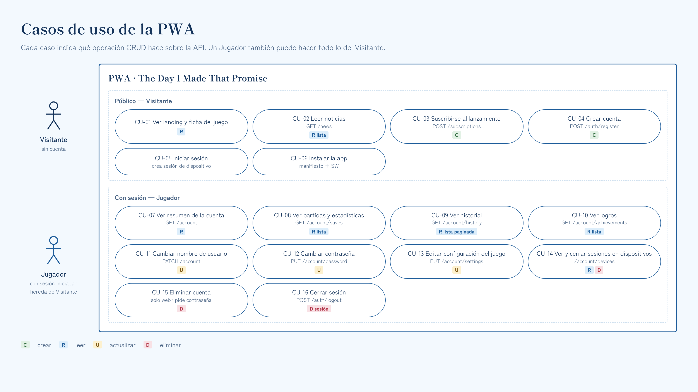

| Entidad | Create | Read | Update | Delete |
|---|---|---|---|---|
| Cuenta (`players`) | Registro (web o móvil) | Perfil y resumen | Nombre de jugador, contraseña | Eliminar cuenta (**solo web**) |
| Configuración (`settings`) | Al registrarse | Sí | Volumen, idioma, pantalla completa, controles | En cascada con la cuenta |
| Sesiones de dispositivo (`auth_sessions`) | Al iniciar sesión | Lista de dispositivos | Rotación del token | Cerrar uno o todos los demás |
| Partidas (`saves`) | Desde el juego | Ranuras y detalle | Desde el juego | En cascada con la cuenta |
| Historial (`play_sessions`, logros, hitos) | Desde el juego | Lista paginada | — | En cascada con la cuenta |
| Noticias (`news_posts`) | Script SQL ([`docs/db/news_hex_studio.sql`](docs/db/news_hex_studio.sql)) | Lista paginada y detalle | Script SQL | Script SQL |
| Aviso de lanzamiento (`launch_subscriptions`) | Formulario público | — | — | — |

**Creación y consulta en base de datos** (requisito del proyecto): el registro inserta el jugador en `players` (`POST /auth/register`) y la PWA lo lee en *Mi cuenta* (`GET /account`); el formulario de la landing inserta en `launch_subscriptions` (`POST /subscriptions`) y las noticias y logros se consultan con `GET /news` y `GET /achievements`. El laboratorio de pruebas lo demuestra con capturas de la base antes y después (§11.2).

---

## 3. Stack tecnológico

| Capa | Tecnología | Para qué |
|---|---|---|
| Frontend | **React 19** + **TypeScript 5.9** sobre **Node.js 24** | Componentes declarativos con tipos |
| Empaquetador | **Vite 8** + `@vitejs/plugin-react` | Servidor de desarrollo, build optimizado y *code splitting* por ruta |
| Rutas | **React Router 8** (modo *data*, rutas `lazy`) | Rutas anidadas con layout privado y carga diferida |
| Datos del servidor | **TanStack Query 5** + persistencia en IndexedDB (`idb-keyval`) | Caché, paginación, reintentos y datos sin conexión |
| Cliente HTTP | **openapi-fetch** + tipos de **openapi-typescript** | Llamadas tipadas a partir del contrato |
| Formularios | **React Hook Form** + **Zod** | Validación declarativa igual a la del backend |
| PWA | **vite-plugin-pwa** (Workbox 7, estrategia `injectManifest`) | Manifiesto, precache y Service Worker propio |
| Estilos y textos | **CSS Modules** + tokens CSS · **react-i18next** (`es.json`) · `react-markdown` | CSS modular por componente; textos fuera del código; noticias en Markdown sin HTML crudo |
| Backend | **Spring Boot 4.1** con **Java 21 LTS**, Maven Wrapper | API REST en N-capas |
| Seguridad | JWT HS256 propio (`HmacTokenIssuer`) + `spring-security-crypto` (BCrypt) | Sesiones con access y refresh token |
| Persistencia | `JdbcClient` de Spring · **Flyway** · HikariCP | Consultas SQL explícitas y migraciones versionadas |
| Contrato | **OpenAPI 3.1** (`docs/api/openapi.yaml`) | Fuente de verdad de la API; de él se generan los tipos del frontend |
| Base de datos | **PostgreSQL** en Supabase (esquema `game`) | Datos de cuentas, partidas, historial y contenido público |
| Despliegue | **Vercel** (PWA) · **Render** (API) · GitHub Actions · Docker Compose (local) | CDN, API y CI/CD en planes gratuitos |
| Pruebas | Vitest, Testing Library, MSW, axe-core, Playwright · JUnit 5, Mockito, AssertJ, ArchUnit, JaCoCo | Unitarias, integración, accesibilidad, laboratorio integral y reglas de arquitectura |

---

## 4. Arquitectura

### 4.1 Contexto

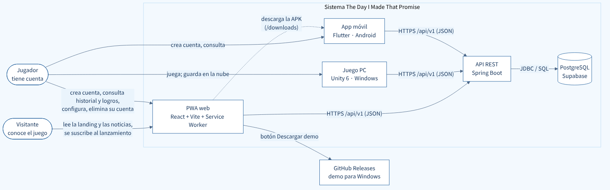

### 4.2 Despliegue

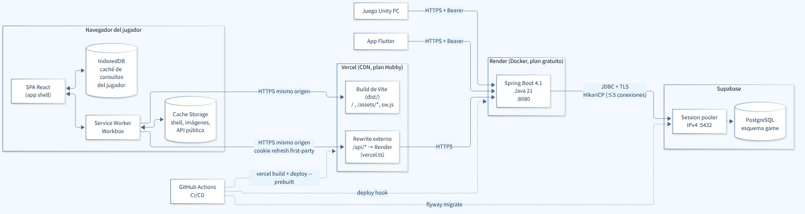

- **La PWA llama a `/api/*` en su propio dominio y Vercel lo reenvía a Render** (rewrite a un origen externo). Así la cookie de sesión es *first-party* y no hace falta CORS. En desarrollo, el proxy de Vite hace lo mismo (`/api` → `API_ORIGIN`), y en Docker lo hace nginx.
- Unity y Flutter llaman directo a Render con `Authorization: Bearer`.
- La API se conecta a PostgreSQL por el *session pooler* de Supabase con un rol que solo puede leer y escribir filas.
- La demo para Windows se descarga de los *releases* del repositorio del juego; la APK de Android la sirve el propio sitio (`/downloads/tdimp-mobile.apk`).

### 4.3 Backend en N-capas

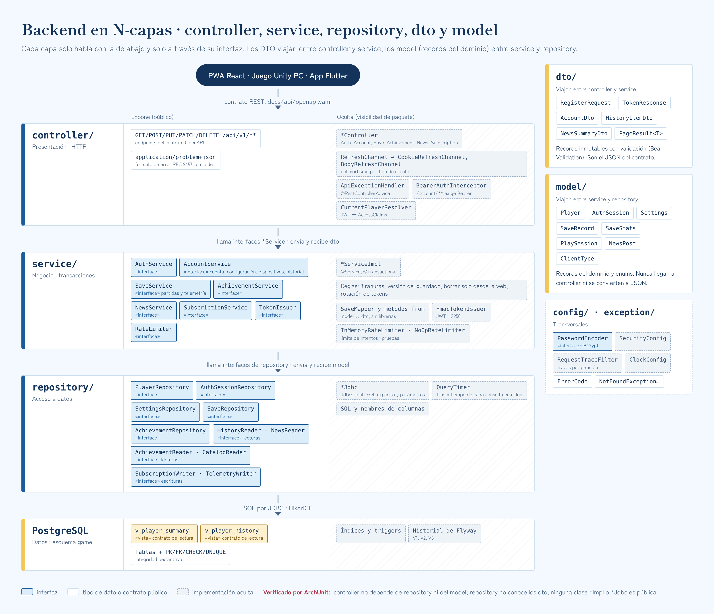

El backend se divide en las capas vistas en clase. Cada capa solo llama a la de abajo y solo a través de su **interfaz**:

| Paquete | Capa | Responsabilidad | Usa |
|---|---|---|---|
| `controller` | Presentación | Rutas HTTP, validación de entrada, token → `AccessClaims`, errores → `problem+json` | `service`, `dto` |
| `service` | Negocio | Reglas, transacciones, tokens, límite de intentos y conversión `model` ↔ `dto` | `repository`, `model`, `dto` |
| `repository` | Acceso a datos | Consultas y escrituras en PostgreSQL con `JdbcClient` | `model` |
| `dto` | Transferencia | *Records* que entran y salen por la API (el JSON del contrato) | — |
| `model` | Dominio | *Records* del dominio y enums | — |
| `exception`, `config` | Transversales | Excepciones con código estable, seguridad, reloj, trazas y propiedades | — |

```text
backend/src/main/java/mx/utch/tdimp/api/
├── TdimpApiApplication.java
├── controller/   AuthController, AccountController, SaveController, AchievementController, NewsController,
│                 SubscriptionController · RefreshChannel «interface» + CookieRefreshChannel, BodyRefreshChannel
│                 BearerAuthInterceptor, CurrentPlayerResolver, WebConfig, ApiExceptionHandler, ClientIp, Slots
├── service/      AuthService, AccountService, SaveService, AchievementService, NewsService, SubscriptionService
│                 «interfaces» + *ServiceImpl · TokenIssuer + HmacTokenIssuer · RateLimiter + InMemoryRateLimiter,
│                 NoOpRateLimiter · AccessClaims, AuthResult, SaveMapper, DeviceNames
├── repository/   PlayerRepository, AuthSessionRepository, SettingsRepository, SaveRepository, AchievementRepository,
│                 AchievementReader, CatalogReader, HistoryReader, NewsReader, SubscriptionWriter, TelemetryWriter
│                 «interfaces» + *Jdbc
├── dto/          RegisterRequest, LoginRequest, TokenResponse, AccountDto, SaveDetailDto, HistoryItemDto,
│                 NewsSummaryDto, NewsPostDto, PageResult<T>, PageQuery, ... (records)
├── model/        Player, AuthSession, Settings, SaveRecord, SaveStats, InventoryItem, PlaySession, GameEvent,
│                 PlayerAchievement, NewsPost, LaunchSubscription, ... · ClientType, SubscriptionSource (enums)
├── exception/    ErrorCode, NotFoundException, ConflictException, VersionConflictException,
│                 UnauthenticatedException, ForbiddenException, TooManyAttemptsException, ...
└── config/       SecurityConfig (PasswordEncoder) · TdimpProperties, RateLimitProperties · ClockConfig
                  RequestTraceFilter, QueryTimer (trazas del laboratorio de pruebas)
```

**Una petición atravesando las capas** (listar noticias, `GET /api/v1/news?page=0&size=6`):

```java
// controller/NewsController.java
@RestController
@RequestMapping("/api/v1/news")
class NewsController {
  private static final CacheControl PUBLIC_5_MIN = CacheControl.maxAge(Duration.ofMinutes(5)).cachePublic();
  private final NewsService news;                                    // service interface

  NewsController(NewsService news) { this.news = news; }             // constructor injection

  @GetMapping
  ResponseEntity<PageResult<NewsSummaryDto>> list(
      @RequestParam(defaultValue = "0") @Min(0) int page,
      @RequestParam(defaultValue = "20") @Min(1) @Max(PageQuery.MAX_SIZE) int size) {
    return ResponseEntity.ok().cacheControl(PUBLIC_5_MIN).body(news.list(new PageQuery(page, size)));
  }
}

// service/NewsService.java — the contract the controller depends on
public interface NewsService {
  PageResult<NewsSummaryDto> list(PageQuery page);
  NewsPostDto get(String slug);
}

// service/NewsServiceImpl.java — hidden implementation (package-private)
@Service
class NewsServiceImpl implements NewsService {
  private final NewsReader reader;                                   // repository interface

  @Override
  @Transactional(readOnly = true)
  public PageResult<NewsSummaryDto> list(PageQuery page) {
    var content = reader.findPublished(page.size(), page.offset()).stream()
        .map(NewsServiceImpl::toSummary)                             // model → dto
        .toList();
    return PageResult.of(content, page, reader.countPublished());
  }
}

// repository/NewsReaderJdbc.java — implements NewsReader with explicit SQL
public List<NewsPost> findPublished(int limit, long offset) {
  return jdbc.sql("""
          select slug, title, summary, content_md, cover_key, published_at
          from news_posts
          where published_at is not null
          order by published_at desc, slug
          limit :limit offset :offset
          """)
      .param("limit", limit).param("offset", offset)
      .query(NewsReaderJdbc::map)
      .list();
}
```

- El id del jugador **siempre sale del token**, nunca de la URL: las rutas privadas son `/account/...` y `CurrentPlayerResolver` entrega `AccessClaims` al controlador, así nadie puede pedir datos de otro.
- Las **clases de `model` nunca llegan a `controller`** ni se convierten a JSON; la API solo devuelve `dto` (lo verifica ArchUnit, §5).

### 4.4 Frontend modular

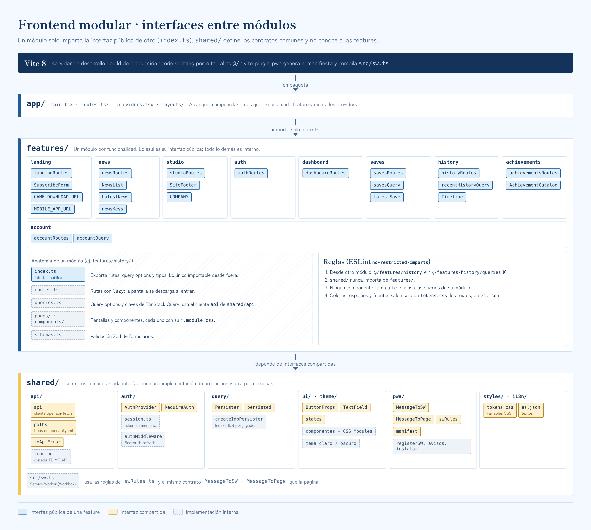

```text
frontend/
├── index.html · vite.config.ts · vitest.config.ts · vercel.ts · eslint.config.js · Dockerfile · nginx/
├── public/                    robots.txt, icons, og-image, screenshots/ (manifest), downloads/ (APK)
├── scripts/                   lab-evidence.mjs (laboratorio de pruebas) · generate-icons.mjs
└── src/
    ├── main.tsx · sw.ts       app entry point · Service Worker (§8.3)
    ├── app/                   routes.tsx, router.ts, providers.tsx · layouts/ (PublicLayout, AppLayout) · pages/ (404, error)
    ├── features/              one module per feature, each one with index.ts (public interface)
    │   ├── landing/ · news/ · studio/ · auth/ · dashboard/ · saves/ · achievements/ · account/
    │   ├── history/           index.ts · routes.ts · queries.ts · pages/HistoryPage · components/ (TypeFilter, Timeline)
    │   └── lab/               diagnóstico del laboratorio, solo en npm run dev
    ├── shared/                nothing here imports from features/
    │   ├── api/               client.ts (openapi-fetch) · schema.d.ts (generated) · problems.ts
    │   ├── auth/              session.ts · authMiddleware.ts · AuthProvider · RequireAuth · offlineSession.ts
    │   ├── query/             queryClient.ts · persister.ts (IndexedDB)
    │   ├── pwa/               manifest.ts · swRules.ts · registerSW.ts · UpdatePrompt · InstallButton · OfflineBanner
    │   ├── ui/                Button, TextField, SelectField, Chip, PageHeader, SkyScene, states, art.ts
    │   ├── theme/             ThemeToggle (claro / oscuro)
    │   ├── i18n/ · lab/       es.json · logger.ts (consola TDIMP)
    │   └── styles/            tokens.css · global.css
    └── test/                  setup.ts · msw/handlers.ts
```

La estructura modular se explica en [§9.2](#92-estructura-modular-en-javascript-y-css).

### 4.5 Repositorio

```text
integradora-web/
├── README.md · SUBMISSION.md · docker-compose.yml
├── .github/workflows/      ci-backend.yml · ci-frontend.yml · contract.yml · cd-staging.yml · cd-production.yml ·
│                           reusable-deploy.yml · docker.yml
├── backend/                Spring Boot (§4.3) · README.md (ejecución local y práctica de pruebas unitarias)
├── frontend/               React + Vite (§4.4)
└── docs/
    ├── api/openapi.yaml    API contract
    ├── db/                 V1–V3 (Flyway) · news_hex_studio.sql · app_role.sql · verify_schema.sql
    ├── testing/            laboratorio de pruebas: README.md · sql/ · evidencias/
    ├── ci/                 pipelines (README.md)
    ├── diagrams/           Mermaid sources (.mmd) + mermaid.config.json
    ├── design/             tokens.css · contrast.py · icon.svg · boards/*.html
    └── img/                exported diagrams, banner and style sheet (PNG)
```

Ramas: `main` (lo publicado en producción y lo que se entrega), `dev` (integración y *staging*) y ramas cortas `feature/*`, `fix/*`, `docs/*` que entran a `dev` por PR con los checks en verde.

---

## 5. Interfaces

Una **interfaz** es el contrato que dice **qué** ofrece un componente sin revelar **cómo** lo hace. Quien consume depende del contrato, nunca de la implementación; así una pieza se cambia sin tocar a las demás (acoplamiento débil), varias implementaciones conviven (polimorfismo) y cada una se sustituye por un doble en las pruebas.

| Nivel | Interfaz (qué) | Implementación (cómo) | La usa |
|---|---|---|---|
| Entre sistemas | API REST [`docs/api/openapi.yaml`](docs/api/openapi.yaml) | Controladores de Spring Boot | PWA, Unity, Flutter |
| Entre capas del backend | `*Service` · `*Repository`, `*Reader`, `*Writer` | `*ServiceImpl` · `*Jdbc` | La capa de arriba |
| Servicios técnicos | `TokenIssuer`, `RateLimiter`, `PasswordEncoder`, `RefreshChannel` | Una o más por contrato (tabla siguiente) | `service`, `controller` |
| Entre módulos del frontend | `index.ts` de cada feature | Pantallas, componentes y queries internos | Router y otras features |
| Contratos del frontend | `paths` (tipos del contrato), `Persister`, `ButtonProps`, `MessageToSW` / `MessageToPage`, reglas de `swRules.ts` | Implementaciones en `shared/` | Features y Service Worker |
| Base de datos | Vistas `v_player_summary`, `v_player_history` | Tablas e índices | `repository` |

**Polimorfismo:** varias implementaciones del mismo contrato.

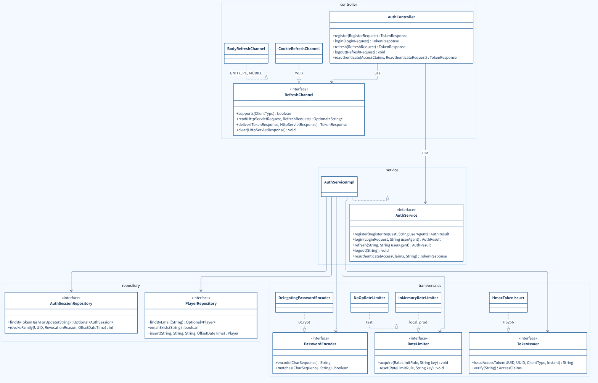

| Interfaz | Implementaciones | Qué se gana |
|---|---|---|
| `RefreshChannel` | `CookieRefreshChannel` (WEB) · `BodyRefreshChannel` (UNITY_PC, MOBILE) | Un solo `AuthController` entrega el refresh token en cookie al navegador y en JSON a los clientes nativos |
| `PasswordEncoder` | `DelegatingPasswordEncoder` → BCrypt | Cambiar a Argon2 sin migrar cuentas |
| `RateLimiter` | `InMemoryRateLimiter` · `NoOpRateLimiter` (pruebas) | Las pruebas no se bloquean por el límite de intentos |
| `TokenIssuer` | `HmacTokenIssuer` (HS256) | Firmar y validar tokens sin que los servicios conozcan la librería |
| `Persister` (frontend) | `createIdbPersister()` (IndexedDB) | La misma persistencia funciona en el navegador y en Vitest (`fake-indexeddb`) |

**Las reglas de capas se verifican en cada build** con ArchUnit; si alguien las rompe, el build falla:

```java
// test/.../ArchitectureTest.java
@ArchTest
static final ArchRule layers = layeredArchitecture().consideringOnlyDependenciesInLayers()
    .layer("Controller").definedBy("..controller..")
    .layer("Service").definedBy("..service..")
    .layer("Repository").definedBy("..repository..")
    .whereLayer("Controller").mayNotBeAccessedByAnyLayer()
    .whereLayer("Service").mayOnlyBeAccessedByLayers("Controller")
    .whereLayer("Repository").mayOnlyBeAccessedByLayers("Service");

@ArchTest  // the API only returns DTOs: controllers never touch the model (enums are allowed)
static final ArchRule controllersNeverSeeEntities = noClasses().that().resideInAPackage("..controller..")
    .should().dependOnClassesThat(resideInAPackage("..model..").and(not(ENUMS)));

@ArchTest  // consumers depend on the interface; implementations stay package-private
static final ArchRule implementationsAreHidden = classes()
    .that().haveSimpleNameEndingWith("Impl").or().haveSimpleNameEndingWith("Jdbc")
    .should().notBePublic();
```

También se comprueba que `repository` no conozca los `dto`, que `model` no dependa de ninguna capa y que toda dependencia se inyecte por constructor.

---

## 6. Base de datos

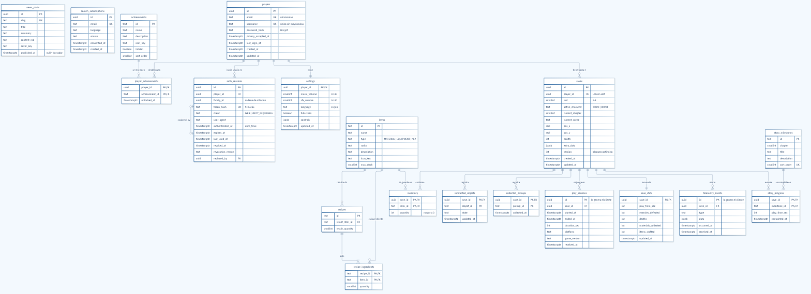

Scripts en [`docs/db/`](docs/db). Las migraciones son las mismas que aplica Flyway al arrancar la API (`backend/src/main/resources/db/migration`) y se probaron en PostgreSQL 16 con [`verify_schema.sql`](docs/db/verify_schema.sql):

| Script | Contenido |
|---|---|
| [`V1__initial_schema.sql`](docs/db/V1__initial_schema.sql) | 19 tablas, 2 vistas, índices y triggers de `updated_at` |
| [`V2__initial_data.sql`](docs/db/V2__initial_data.sql) | Catálogos iniciales (objetos, receta, logros, hitos) y dos noticias de ejemplo |
| [`V3__chapter1_catalog.sql`](docs/db/V3__chapter1_catalog.sql) | Catálogo final del capítulo 1: objetos, recetas de la forja e hitos de historia |
| [`news_hex_studio.sql`](docs/db/news_hex_studio.sql) | Noticias publicadas de Hex Studio (9 y un borrador); reemplaza las de ejemplo |
| [`app_role.sql`](docs/db/app_role.sql) | Rol `tdimp_app` de la API, solo con permisos de lectura y escritura de filas |
| [`verify_schema.sql`](docs/db/verify_schema.sql) | Aserciones; corre en una transacción que se revierte |

**Importar la base desde cero** (PostgreSQL 16, `psql`):

```bash
createdb tdimp
psql -d tdimp -c "create schema game"
for f in V1__initial_schema V2__initial_data V3__chapter1_catalog; do
  psql -d tdimp -v ON_ERROR_STOP=1 -c "set search_path=game" -f docs/db/$f.sql
done
psql -d tdimp -f docs/db/news_hex_studio.sql
psql -d tdimp -f docs/db/verify_schema.sql
```

O simplemente arrancar la API: Flyway crea el esquema `game` y aplica V1–V3. Los datos del laboratorio de pruebas tienen sus propios scripts de carga y limpieza ([`docs/testing/sql/`](docs/testing/sql)).

| Grupo | Tablas |
|---|---|
| Cuenta y sesiones | `players`, `auth_sessions` (refresh tokens hasheados), `settings` |
| Partidas | `saves` (ranuras 1–3 con `version`), `save_stats`, `inventory`, `collected_pickups`, `interacted_objects`, `story_progress` |
| Historial y logros | `play_sessions`, `telemetry_events`, `player_achievements` |
| Catálogos | `items`, `recipes`, `recipe_ingredients`, `achievements`, `story_milestones` |
| Contenido público | `news_posts`, `launch_subscriptions` |
| Vistas de lectura | `v_player_summary` (resumen de la cuenta) · `v_player_history` (sesiones, logros e hitos en una línea de tiempo) |

**Convenciones:** tablas y columnas en inglés y `snake_case`; `created_at` / `updated_at` en UTC; integridad con PK, FK, `CHECK` y `UNIQUE`; eliminar una cuenta borra sus datos en cascada. Los textos que ve el jugador (nombres de logros, noticias) se guardan en español.

---

## 7. Consumo de API

La PWA recupera listas de datos de endpoints remotos y las pinta dinámicamente. El contrato completo está en [`docs/api/openapi.yaml`](docs/api/openapi.yaml) (OpenAPI 3.1); de él se generan los tipos de TypeScript (`npm run gen:api`), así que si un endpoint cambia, el compilador marca cada uso roto. El workflow `contract.yml` revisa el contrato y avisa de cambios incompatibles en cada PR.

### 7.1 Convenciones

| Tema | Regla |
|---|---|
| Base | `/api/v1`, JSON en `camelCase`, fechas ISO-8601 en UTC |
| Listas paginadas | `?page=0&size=20` (máx. 50) → `{ "content": [...], "page": { "number", "size", "totalElements", "totalPages" } }` |
| Errores | `application/problem+json` (RFC 9457) con un `code` estable; la PWA muestra su propio texto según el `code` |
| Caché HTTP | Datos privados: `no-store`. Noticias: `public, max-age=300`. Catálogo de logros: `public, max-age=3600` |
| Trazas | Cada respuesta lleva `X-Request-Id` y `Server-Timing` (tiempo en Spring y en PostgreSQL) |

### 7.2 Endpoints

| Método y ruta | Devuelve | Auth | Lo usa |
|---|---|---|---|
| `POST /auth/register` · `/auth/login` · `/auth/refresh` · `/auth/logout` | Tokens / 204 | — | Todos los clientes |
| `POST /auth/reauthenticate` | Token reciente | Bearer | PWA (antes de eliminar) |
| `GET` · `PATCH` · `DELETE /account` | Cuenta y resumen | Bearer | `DELETE` solo PWA |
| `PUT /account/password` · `GET`/`PUT /account/settings` | — / configuración | Bearer | PWA, juego, móvil |
| `GET /account/devices` · `DELETE /account/devices[/{id}]` | **Lista** de dispositivos | Bearer | PWA |
| `GET /account/saves` · `GET /account/saves/{slot}` | **Lista** de ranuras · detalle | Bearer | PWA, móvil |
| `GET /account/history?type=` | **Lista paginada** de la línea de tiempo | Bearer | PWA |
| `GET /account/sessions?slot=` | **Lista paginada** de sesiones de juego | Bearer | PWA |
| `GET /account/achievements` | **Lista** de logros con estado | Bearer | PWA, móvil |
| `GET /news` · `GET /news/{slug}` | **Lista paginada** · detalle | — | PWA, móvil |
| `GET /achievements` | **Lista** del catálogo | — | PWA |
| `POST /subscriptions` | 202 | — | PWA (landing) |
| `GET`/`PUT /account/saves/{slot}/data` · `POST .../sessions` · `POST .../events` · `PUT /account/achievements/{id}` | Guardado y telemetría | Bearer | Juego Unity |

### 7.3 JSON de ejemplo

**Lista paginada** · `GET /news?page=0&size=6`
```json
{
  "content": [
    { "slug": "ya-puedes-jugar-la-demo-del-capitulo-1", "title": "Ya puedes jugar la demo del capítulo 1",
      "summary": "Dos zonas, la forja de Kaede y el duelo contra Varn. Descarga gratis la demo para Windows y juega de 20 a 30 minutos.",
      "coverKey": "news_demo", "publishedAt": "2026-11-21T00:00:00Z" },
    { "slug": "conoce-a-varn-el-guardian-del-umbral", "title": "Conoce a Varn, el Guardián del Umbral",
      "summary": "Escudo, puños y una espada que guarda en el pecho. Así diseñamos al primer guardián del camino al Gran Juzgado.",
      "coverKey": "news_devlog05", "publishedAt": "2026-11-16T18:00:00Z" }
  ],
  "page": { "number": 0, "size": 6, "totalElements": 9, "totalPages": 2 }
}
```

**Lista sin paginar** · `GET /account/achievements` (los logros ocultos y bloqueados llegan enmascarados)
```json
[
  { "id": "first_craft", "name": "El poder se fabrica", "description": "Fabrica tu primer objeto en la forja.",
    "iconKey": "achievement_forge", "hidden": false, "sortOrder": 20, "unlocked": true, "unlockedAt": "2026-10-10T01:53:00Z" },
  { "id": "rulebreaker", "name": "Logro oculto", "description": null,
    "iconKey": null, "hidden": true, "sortOrder": 50, "unlocked": false, "unlockedAt": null }
]
```

**Petición de la PWA** · `POST /auth/register` (en web el refresh token vuelve en una cookie `HttpOnly`, nunca en el JSON)
```json
{ "email": "felc@example.com", "username": "Felc", "password": "a-long-passphrase", "acceptedPrivacyNotice": true, "client": "WEB" }
```

**Documento que produce el juego** · `PUT /account/saves/{slot}/data` (la API lo reparte en tablas; `version` evita que dos computadoras se pisen el avance)
```json
{
  "version": 7, "activeCharacter": "TSUKI", "currentChapter": 1, "currentScene": "Zone1_Forest",
  "stats": { "playTimeSec": 6720, "enemiesDefeated": 61, "deaths": 3, "materialsCollected": 40, "itemsCrafted": 2 },
  "inventory": [ { "itemId": "alma_antigua", "quantity": 5 } ],
  "completedMilestones": [ { "milestoneId": "met_researcher", "playTimeSec": 300, "completedAt": "2026-10-09T23:10:00Z" } ],
  "collectedPickups": [ "zone1:pickup_01" ], "objects": [], "extraData": { "v": 1 }
}
```

**Error** · `400`
```json
{ "type": "https://tdimp.app/problems/validation-failed", "title": "Validation failed", "status": 400,
  "code": "VALIDATION_FAILED", "errors": [ { "field": "username", "code": "Pattern", "message": "Must be 3 to 20 letters, digits or underscores." } ] }
```

### 7.4 Cliente HTTP

Un solo cliente tipado para toda la app (`shared/api/client.ts`). Usa el mismo origen que la página (el proxy reenvía `/api`) y registra cada petición en la consola, que es la evidencia del laboratorio de pruebas:

```ts
// shared/api/client.ts
import createClient, { type Middleware } from 'openapi-fetch'
import type { paths } from './schema'                     // generated from docs/api/openapi.yaml
import { formatBytes, log } from '@/shared/lab/logger'

export const API_BASE_URL = `${globalThis.location?.origin ?? 'http://localhost'}/api/v1`

const tracing: Middleware = {
  onRequest({ request }) { /* TDIMP API → GET /api/v1/news?page=0&size=6 */ return request },
  async onResponse({ request, response }) {
    // TDIMP API ← 200 GET /api/v1/news en 42 ms · 1.8 KB  (+ X-Request-Id, Server-Timing, Cache-Control)
    return response
  },
}

export const api = createClient<paths>({ baseUrl: API_BASE_URL, fetch: (request) => globalThis.fetch(request) })
api.use(tracing)
```

La sesión agrega su propio *middleware* (`shared/auth/authMiddleware.ts`): pone el token en las rutas privadas y, si la API responde `401 TOKEN_EXPIRED` o `INVALID_SESSION`, renueva el token **una sola vez** aunque fallen varias peticiones a la vez y repite la petición:

```ts
// shared/auth/authMiddleware.ts
const PRIVATE = /^\/api\/v1\/(account(\/|$)|auth\/reauthenticate$)/
const RENEWABLE = new Set(['TOKEN_EXPIRED', 'INVALID_SESSION'])

export const authMiddleware: Middleware = {
  async onRequest({ request }) {
    if (!isPrivate(request)) return undefined
    const token = await getAccessToken()                    // renews 30 s before it expires
    if (token) request.headers.set('Authorization', `Bearer ${token}`)
    pending.set(request, request.clone())                   // the body can be read only once
    return request
  },
  async onResponse({ request, response }) {
    if (response.status !== 401 || !isPrivate(request)) return undefined
    const copy = pending.get(request)
    if (!copy || !RENEWABLE.has((await codeOf(response)) ?? '')) return undefined
    if (!(await refreshSession())) return undefined          // shared refresh: one call for all requests
    copy.headers.set('Authorization', `Bearer ${await getAccessToken()}`)
    const retried = await globalThis.fetch(copy)
    if (retried.status === 401) endSession()                 // RequireAuth sends the player to /login
    return retried
  },
}
```

El access token vive solo en memoria (`shared/auth/session.ts`), nunca en `localStorage`; el refresh token es una cookie `HttpOnly` que JavaScript no ve. Las lecturas que fallan por red o 5xx se reintentan; los 4xx no.

### 7.5 Listas dinámicas

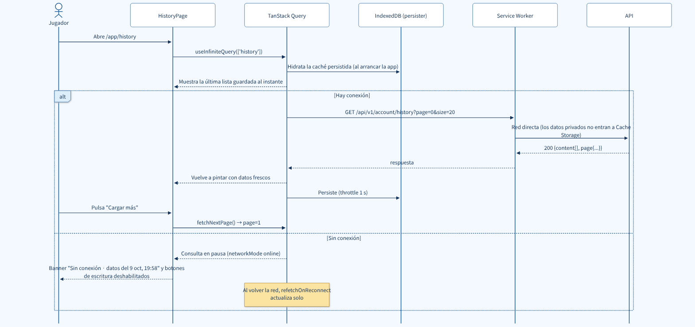

Cada lista es una consulta de TanStack Query con su clave. La caché evita pedir dos veces lo mismo y las del jugador se guardan en IndexedDB para verse sin conexión:

| Lista | Endpoint | Clave | Pantalla | Sin conexión |
|---|---|---|---|---|
| Noticias | `GET /news` (paginada) | `['news', 'list', size]` · `['news', 'latest', 3]` | Noticias, Landing | Caché del SW (`public-api`) |
| Catálogo de logros | `GET /achievements` | `['achievements', 'catalog']` | Landing | Caché del SW (`public-api`) |
| Ranuras | `GET /account/saves` | `['account', 'saves']` | Resumen, Partidas | IndexedDB |
| Historial | `GET /account/history` (paginada) | `['account', 'history', { type }]` | Historial, Resumen | IndexedDB (páginas ya cargadas) |
| Sesiones de una partida | `GET /account/sessions` (paginada) | `['account', 'sessions', { slot }]` | Detalle de partida | — |
| Logros del jugador | `GET /account/achievements` | `['account', 'achievements']` | Logros, Resumen | IndexedDB |
| Dispositivos | `GET /account/devices` | `['account', 'devices']` | Seguridad | — |

Todo lo del jugador empieza con `'account'`: al cerrar sesión se borra con una sola instrucción y ningún dato queda para el siguiente.

**La consulta** (paginación incremental con `useInfiniteQuery`):

```ts
// features/news/queries.ts
export const NEWS_PAGE_SIZE = 6

export const newsListInfiniteQuery = (size: number = NEWS_PAGE_SIZE) =>
  infiniteQueryOptions({
    queryKey: newsKeys.list(size),
    initialPageParam: 0,
    queryFn: async ({ pageParam }) => {
      const { data, error, response } = await api.GET('/news', { params: { query: { page: pageParam, size } } })
      if (error || !data) throw toApiError(error, response.status)
      return data
    },
    getNextPageParam: (last) => (last.page.number + 1 < last.page.totalPages ? last.page.number + 1 : undefined),
  })
```

**El renderizado** (cuatro estados en toda lista):

```tsx
// features/news/components/NewsList.tsx
export function NewsList() {
  const { t } = useTranslation()
  const q = useInfiniteQuery(newsListInfiniteQuery())
  const items = q.data?.pages.flatMap((p) => p.content) ?? []
  const total = q.data?.pages[0]?.page.totalElements ?? 0

  if (q.isPending) return <Skeleton rows={3} />
  if (q.isError) return <ErrorState error={q.error} onRetry={() => void q.refetch()} />
  if (items.length === 0) return <EmptyState title={t('news.empty.title')} text={t('news.empty.text')} />

  return (
    <div data-list="news">
      <p aria-live="polite">{t('news.count', { shown: items.length, total })}</p>
      <ul>{items.map((n) => <li key={n.slug} data-testid="news-item"><NewsCard news={n} /></li>)}</ul>
      {q.hasNextPage && (
        <Button variant="outline" onClick={() => void q.fetchNextPage()} loading={q.isFetchingNextPage}>
          {t('common.loadMore')}
        </Button>
      )}
    </div>
  )
}
```

| Estado | Qué ve el jugador |
|---|---|
| Cargando | Esqueleto con la forma real de la lista (sin saltos de diseño) |
| Error | Qué pasó y un botón **Reintentar** |
| Vacía | Qué hacer para llenarla ("Juega una partida con tu cuenta iniciada y aparecerá aquí.") |
| Con datos | La lista; **Cargar más** pide la siguiente página (accesible con teclado, no atrapa el pie de página) |

Los textos viven en `shared/i18n/es.json` con claves en inglés:

```json
{
  "common": { "loadMore": "Cargar más", "retry": "Reintentar" },
  "news": { "count": "{{shown}} de {{total}}" },
  "errors": { "INVALID_CREDENTIALS": "Correo o contraseña incorrectos.", "NETWORK_ERROR": "No hay conexión con el servidor. Revisa tu internet." }
}
```

---

## 8. Estrategia PWA

### 8.1 Manifiesto

Vive en [`frontend/src/shared/pwa/manifest.ts`](frontend/src/shared/pwa/manifest.ts) (así las pruebas comprueban sus atajos y capturas) y `vite-plugin-pwa` lo publica como `/manifest.webmanifest`:

```json
{
  "id": "/",
  "name": "The Day I Made That Promise",
  "short_name": "The Promise",
  "description": "Tu progreso, tus logros y las noticias del juego.",
  "lang": "es-MX",
  "start_url": "/app?source=pwa",
  "scope": "/",
  "display": "standalone",
  "background_color": "#F6EEF6",
  "theme_color": "#F6EEF6",
  "categories": ["games", "entertainment"],
  "icons": [
    { "src": "/pwa-192x192.png", "sizes": "192x192", "type": "image/png" },
    { "src": "/pwa-512x512.png", "sizes": "512x512", "type": "image/png" },
    { "src": "/maskable-icon-512x512.png", "sizes": "512x512", "type": "image/png", "purpose": "maskable" }
  ],
  "screenshots": [
    { "src": "/screenshots/landing-wide.webp", "sizes": "1280x720", "type": "image/webp", "form_factor": "wide", "label": "Página principal del juego en escritorio" },
    { "src": "/screenshots/landing-narrow.webp", "sizes": "390x844", "type": "image/webp", "form_factor": "narrow", "label": "Página principal del juego en el teléfono" }
  ],
  "shortcuts": [
    { "name": "Historial", "url": "/app/history?source=shortcut" },
    { "name": "Logros", "url": "/app/achievements?source=shortcut" }
  ]
}
```

### 8.2 Qué guarda cada caché

| Recurso | Estrategia | Dónde | Expira |
|---|---|---|---|
| App shell: HTML, JS, CSS, fuentes, íconos | **Precache** con revisión por build (`js, css, html, svg, png, woff2`) | Cache Storage | Al activar una versión nueva |
| Navegaciones (`/`, `/app/...`) | `index.html` precacheado | Cache Storage | — |
| Imágenes (arte del juego en webp) | **CacheFirst** | `images` | 120 entradas / 30 días |
| `GET /api/v1/news`, `/news/{slug}`, `/achievements` | **StaleWhileRevalidate** | `public-api` | 50 entradas / 1 día |
| `POST /api/v1/subscriptions` sin red | **Cola de Background Sync** | IndexedDB `subscription-queue` | 24 horas |
| `/api/v1/auth/**`, `/api/v1/account/**` | El SW no los toca | — | — |
| `/downloads/*.apk` | El SW no lo intercepta ni lo precachea (48 MB) | — | — |

Los datos del jugador **no van a Cache Storage**, porque esa caché es del sitio, no del usuario: en una computadora compartida el siguiente vería los datos del anterior. Van a IndexedDB a través de TanStack Query, marcados con el id del jugador y borrados al cerrar sesión ([§8.5](#85-sin-conexión)).

### 8.3 Service Worker (`src/sw.ts`)

Estrategia `injectManifest`: el plugin inyecta la lista de precache y el resto es código propio. Las decisiones (qué se cachea, qué se encola, cómo se reenvía la cola) viven en `shared/pwa/swRules.ts` para probarlas sin un worker real; `sw.ts` solo las conecta con Workbox:

```ts
/// <reference lib="webworker" />
import { clientsClaim } from 'workbox-core'
import { precacheAndRoute, cleanupOutdatedCaches, createHandlerBoundToURL } from 'workbox-precaching'
import { registerRoute, NavigationRoute } from 'workbox-routing'
import { StaleWhileRevalidate, CacheFirst } from 'workbox-strategies'
import { ExpirationPlugin } from 'workbox-expiration'
import { CacheableResponsePlugin } from 'workbox-cacheable-response'
import { Queue } from 'workbox-background-sync'
import {
  IMAGES_CACHE, isImage, isPublicApi, isSkipWaiting, isSubscription, NAVIGATION_DENYLIST, PUBLIC_API_CACHE,
  replayQueue, sendOrQueueSubscription, SUBSCRIPTION_QUEUE,
} from './shared/pwa/swRules'

declare const self: ServiceWorkerGlobalScope
clientsClaim()

// 1. App shell (/api/ and /downloads/ never get index.html)
precacheAndRoute(self.__WB_MANIFEST)
cleanupOutdatedCaches()
registerRoute(new NavigationRoute(createHandlerBoundToURL('/index.html'), { denylist: NAVIGATION_DENYLIST }))

// 2. Public API: answer from cache right away and refresh in the background
registerRoute(
  ({ url, request }) => isPublicApi(url, request.method),
  new StaleWhileRevalidate({
    cacheName: PUBLIC_API_CACHE.name,
    plugins: [
      new CacheableResponsePlugin({ statuses: [...PUBLIC_API_CACHE.statuses] }),
      new ExpirationPlugin({ maxEntries: PUBLIC_API_CACHE.maxEntries, maxAgeSeconds: PUBLIC_API_CACHE.maxAgeSeconds }),
    ],
  }),
)

// 3. Images
registerRoute(({ request }) => isImage(request.destination),
  new CacheFirst({ cacheName: IMAGES_CACHE.name,
    plugins: [new ExpirationPlugin({ maxEntries: IMAGES_CACHE.maxEntries, maxAgeSeconds: IMAGES_CACHE.maxAgeSeconds })] }))

// 4. Background: the subscription is retried on its own when the network comes back
const subscriptionQueue = new Queue(SUBSCRIPTION_QUEUE.name, {
  maxRetentionTime: SUBSCRIPTION_QUEUE.maxRetentionMinutes,
  onSync: async ({ queue }) => { await replayQueue(queue, (request) => fetch(request), notify) },  // notify → "Volvió la conexión"
})
registerRoute(({ url }) => isSubscription(url),
  ({ request }) => sendOrQueueSubscription(request, subscriptionQueue, (r) => fetch(r), notify),  // offline → 202 + X-Queued: 1
  'POST')

// 5. Update only when the user decides
self.addEventListener('message', (event: ExtendableMessageEvent) => {
  if (isSkipWaiting(event.data)) void self.skipWaiting()
})
```

Cada paso escribe en la consola con el prefijo `[SW]` (instalación, caché usada o actualizada, red caída, reenvío de la cola), que es lo que se captura en el laboratorio de pruebas.

### 8.4 Ciclo de vida y actualización

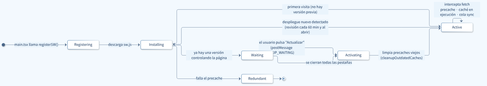

- Con `registerType: 'prompt'`, cuando hay versión nueva aparece el aviso **"Hay una versión nueva de la app. Actualizar"**; al pulsarlo la página envía `SKIP_WAITING` y se recarga.
- Se revisa si hay versión nueva al abrir la app y cada 60 minutos. Nunca se actualiza a la fuerza: el jugador podría estar llenando un formulario.

### 8.5 Sin conexión

```tsx
// app/providers.tsx — TanStack Query persists the player's queries in IndexedDB
const persister = createIdbPersister(() => readOfflineSession()?.id ?? null)   // every snapshot stamped with its owner

<PersistQueryClientProvider
  client={queryClient}
  persistOptions={{
    persister,
    maxAge: PERSIST_MAX_AGE,                                    // 7 days
    buster,                                                     // the player saved when the app opened
    dehydrateOptions: { shouldDehydrateQuery: shouldPersistQuery },  // meta.persist && status === 'success'
  }}>
```

- Se guardan el resumen, las partidas y su detalle, las páginas cargadas del historial, la actividad reciente, los logros y la configuración.
- **Al abrir sin red o con la API caída (5xx):** si hay una sesión guardada (`tdimp.offline-session`, sin tokens), la app entra en **modo lectura**: muestra lo guardado, el aviso "Sin conexión" y desactiva los botones que escriben (`useReadOnly`). Al volver la red, renueva la sesión y refresca solo.
- **Al cerrar sesión o eliminar la cuenta** se borran la caché de consultas, la copia en IndexedDB y la sesión guardada.

### 8.6 Funcionamiento en segundo plano

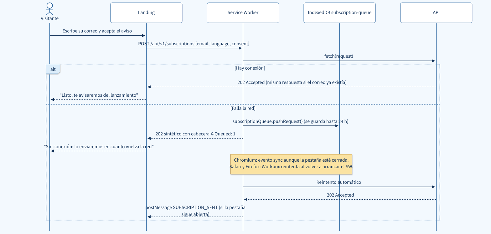

| Trabajo en segundo plano | Cómo |
|---|---|
| Enviar la suscripción hecha sin red | Background Sync (`Queue` de Workbox). En Chromium se dispara aunque la pestaña esté cerrada; en Safari y Firefox, al volver a arrancar el SW |
| Mantener noticias y logros al día | *Stale-while-revalidate*: se muestra lo guardado y se actualiza detrás |
| Descargar la versión nueva de la app | El SW nuevo se instala y precachea mientras el jugador usa la actual |
| Refrescar datos al volver | `refetchOnWindowFocus` y `refetchOnReconnect` de TanStack Query |

Solo la suscripción va a la cola porque es pública: una petición con `Authorization` se reenviaría horas después con el token ya vencido. Para lo privado, el modo lectura es más honesto que encolar cambios que podrían fallar sin avisar.

### 8.7 Instalación y verificación

- **Chrome, Edge y Android:** `InstallButton` guarda el evento `beforeinstallprompt` y muestra **"Instalar app"** en la navegación del panel y en la sección *Descarga la demo* de la landing; el diálogo de instalación muestra las capturas del manifiesto. **iOS:** el botón explica *Compartir → Agregar a inicio*. Si la app ya está instalada, el botón no aparece.
- **Verificación** (laboratorio de pruebas, §11.2): manifiesto sin advertencias en DevTools; SW activo; con *Offline* marcado las noticias visitadas cargan desde Cache Storage; una suscripción sin red llega a la base al volver la red; una versión nueva muestra "Actualizar"; al cerrar sesión IndexedDB queda vacío.

---

## 9. Experiencia de usuario (UI/UX)

### 9.1 Dirección de arte: islas en el cielo

La historia ocurre en islas suspendidas sobre las nubes. La interfaz toma el arte del juego y lo lleva a la web:

- **El cielo como lienzo:** degradado pastel rosa-lavanda (de día) o azul marino nocturno (de noche) con islas pixel art en capas de *parallax*, pétalos de cerezo y luciérnagas.
- **Vidrio sobre el cielo:** barras, tarjetas y paneles de vidrio translúcido (`.glass`) con esquinas poco redondeadas, cercanas al pixel art.
- **El color cuenta la historia:** morado **primario** orienta (navegación, enlaces), rosa **promesa** invita (descargar, crear cuenta, progresar), verde confirma y el carmesí solo marca lo irreversible y los errores.
- **Material real del juego:** leyenda en seis viñetas, ilustraciones de cada zona, personajes (Tsuki, Hikari, Kaede, Varn) y una galería de ocho capturas con visor.
- **Inspiración:** sitios de juegos con elenco y secciones a pantalla completa (Genshin Impact), landings con *parallax* de islas y una sola llamada a la acción siempre visible (*Descargar demo*).

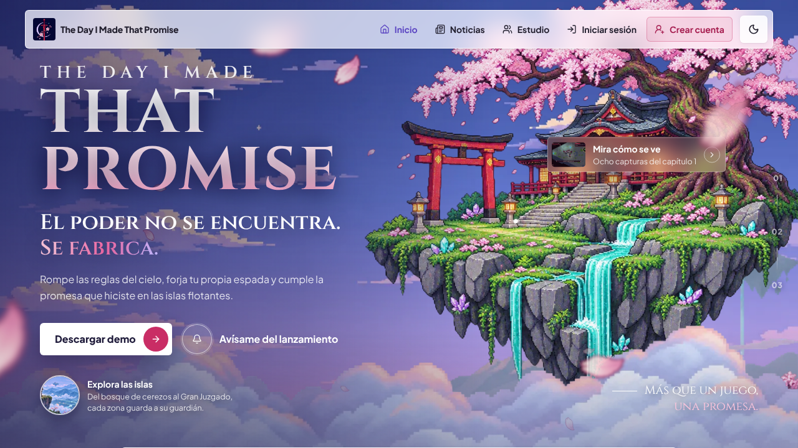

### 9.2 Estructura modular en JavaScript y CSS

**JavaScript (TypeScript):** un módulo por funcionalidad en `features/`. Cada uno publica su interfaz en `index.ts` y esconde lo demás:

```ts
// features/news/index.ts — the only thing other modules may import
export { newsRoutes } from './routes'
export { NewsList } from './components/NewsList'
export { LatestNews } from './components/LatestNews'
export { newsKeys, type NewsPost, type NewsSummary } from './queries'
```

1. Un módulo solo importa de otro su interfaz pública: `@/features/news`, nunca `@/features/news/queries` (lo impide la regla `no-restricted-imports` de ESLint).
2. `shared/` nunca importa de `features/`.
3. Ningún componente llama a `fetch`: usa las queries de su módulo.
4. Las páginas se cargan con `lazy`, así la landing descarga lo mínimo.

**CSS:** cada componente o módulo tiene su `*.module.css` (clases con alcance local, sin choques de nombres) y todos los valores salen de los tokens de [`frontend/src/shared/styles/tokens.css`](frontend/src/shared/styles/tokens.css):

```tsx
// shared/ui/Button.tsx — the props are the public interface of the component
export interface ButtonProps extends ButtonHTMLAttributes<HTMLButtonElement> {
  variant?: 'primary' | 'promise' | 'outline' | 'danger' | 'ghost'
  size?: 'm' | 's'
  loading?: boolean
}

export function Button({ variant = 'primary', size = 'm', loading = false, disabled, type = 'button', className, children, ...rest }: ButtonProps) {
  return (
    <button {...rest} type={type} data-variant={variant} data-size={size}
            className={[css.button, className].filter(Boolean).join(' ')}
            disabled={disabled || loading} aria-busy={loading}>
      {loading && <span className={css.spinner} aria-hidden="true" />}
      {children}
    </button>
  )
}
```

```css
/* shared/ui/Button.module.css — each variant only changes the local variables */
.button {
  --bg: var(--c-primary); --fg: var(--c-on-primary); --bd: transparent; --sh: var(--glow-primary);
  min-height: 46px; padding: 0 var(--s-5); border-radius: var(--radius-pill);
  border: 1px solid var(--bd); background: var(--bg); color: var(--fg); box-shadow: var(--sh);
}
.button[data-variant="promise"] { --bg: var(--c-promise); --fg: var(--c-on-promise); --sh: var(--glow-promise); }
.button[data-variant="danger"]  { --bg: var(--c-danger);  --fg: var(--c-on-danger); }
.button[data-variant="outline"] { --bg: var(--c-glass-strong); --fg: var(--c-text); --bd: var(--c-glass-border); }
```

| Token | Tema claro (por defecto) | Tema oscuro | Contraste mínimo |
|---|---|---|---|
| `--c-bg` / `--c-glass-solid` | `#F6EEF6` / `#F4F1FB` | `#10182B` / `#1E233E` | — |
| `--c-text` | `#23202F` | `#F6F0F8` | 13.7 : 1 |
| `--c-text-muted` | `#655E75` | `#BDB5CF` | 5.5 : 1 |
| `--c-primary` (navegación, enlaces) | `#5B45C2` | `#B3A4FF` | 6.1 : 1 |
| `--c-promise` (descargar, crear cuenta, progreso) | `#C92D65` | `#FF6FAE` | 4.7 : 1 |
| `--c-danger` / `--c-error` (irreversible, errores) | `#B4233C` + texto blanco | `#FF8FA3` | 5.8 : 1 |
| `--c-success` | `#2C7A5F` | `#7FD8B4` | 4.6 : 1 |
| `--c-focus` | `#5B45C2` | `#9FD8FF` | ≥ 3 : 1 |

Los contrastes se comprueban en cada build con una prueba de Vitest (`src/app/a11y.test.tsx`, WCAG 2.2 AA) y con [`docs/design/contrast.py`](docs/design/contrast.py). El tema se elige con el botón de luna/sol (se guarda en el navegador) o sigue a `prefers-color-scheme`. Tipografías autohospedadas: **Cinzel** (títulos y nombre del juego), **Plus Jakarta Sans** (texto) y **Pixelify Sans** (cifras tipo HUD y etiquetas).

### 9.3 Diseño adaptativo

| Ancho | Sitio público | Panel del jugador |
|---|---|---|
| < 440 px | Barra solo con íconos (también *Crear cuenta*); una columna; galería en 2 columnas con solo el número | Pestañas desplazables; tarjetas apiladas |
| 440–599 px | Barra con íconos y *Crear cuenta* con texto | Pestañas desplazables; sin botón de instalar en la barra |
| 600–899 px | Navegación con texto; secciones apiladas | Pestañas completas; tarjetas apiladas |
| 900–1099 px | Historia, app móvil y descarga a dos columnas; capítulos alternados; galería 4 × 2 | Detalle de partida con widgets a dos columnas |
| ≥ 1024 px / 1100 px | Leyenda en 3 columnas; héroe a pantalla completa con índice 01 · 02 · 03 | Resumen a dos columnas (progreso y actividad); sesiones a dos columnas |

- *Mobile first*: el CSS base es el del teléfono y se agregan `@media (min-width: …)`.
- Unidades `rem`, títulos con `clamp()` y objetivos táctiles de al menos 40 × 40 px.
- Arte en webp a dos anchos con `srcSet` (el navegador baja el que necesita); sprites con `image-rendering: pixelated`.
- Imágenes con `loading="lazy"` fuera de la primera pantalla.

### 9.4 Rutas y pantallas

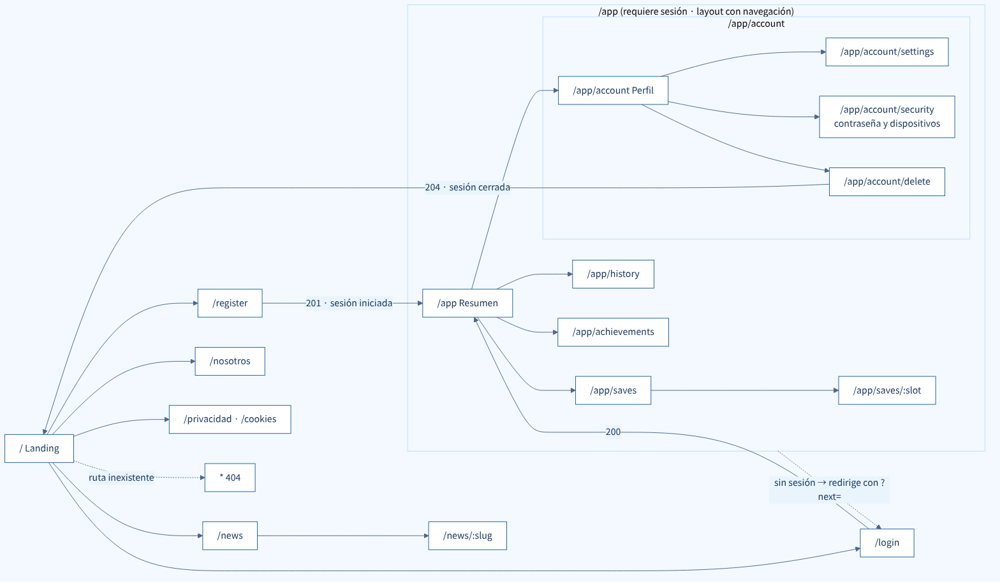

| Ruta | Pantalla | Datos | Sesión |
|---|---|---|---|
| `/` | Landing | `GET /news?size=3`, `GET /achievements`, `POST /subscriptions` | No |
| `/news`, `/news/:slug` | Noticias | `GET /news`, `GET /news/{slug}` | No |
| `/nosotros`, `/privacidad`, `/cookies` | Sobre Hex Studio y páginas legales | — | No |
| `/register`, `/login` | Crear cuenta, iniciar sesión | `POST /auth/register`, `POST /auth/login` | No |
| `/app` | Resumen | `GET /account`, `/account/saves`, `/account/history?size=5` | Sí |
| `/app/saves`, `/app/saves/:slot` | Partidas y detalle | `GET /account/saves[/{slot}]`, `/account/sessions` | Sí |
| `/app/history` | Historial | `GET /account/history` | Sí |
| `/app/achievements` | Logros | `GET /account/achievements` | Sí |
| `/app/account/...` | Perfil, configuración, seguridad, eliminar cuenta | `/account`, `/account/settings`, `/account/devices` | Sí |
| `*` | Página no encontrada (torii roto) | — | No |

### 9.5 Accesibilidad (WCAG 2.2 AA)

- Contraste verificado en ambos temas; el color nunca es la única señal.
- Foco visible, orden lógico y enlace "Saltar al contenido".
- Formularios con `<label>`, errores ligados con `aria-describedby`; avisos en `aria-live="polite"`; visor de la galería con `<dialog>` nativo y flechas del teclado.
- `prefers-reduced-motion` apaga las animaciones (pétalos, *parallax*, entradas de sección).
- Revisión automática con `eslint-plugin-jsx-a11y` y **axe-core** en Vitest sobre las rutas públicas, el 404 y el panel con sesión.

---

## 10. Seguridad y sesiones

| | Access token | Refresh token |
|---|---|---|
| Formato y vida | JWT HS256 de 15 minutos (`sub`, `sid`, `cli`, `auth_time`) | Aleatorio, 30 días, **rota en cada uso** |
| En la PWA | Solo en memoria | Cookie `HttpOnly; Secure; SameSite=Strict` |
| En Unity / Flutter | Memoria | Almacenamiento seguro del sistema |
| En la BD | No se guarda | Solo su hash SHA-256 en `auth_sessions` |

- **Rotación con detección de reuso:** si alguien presenta un refresh token ya usado, se revoca toda su cadena y hay que volver a entrar.
- **La cuenta se crea desde la web o la app móvil y solo se elimina desde la web:** `DELETE /account` exige que el token sea del cliente `WEB` y que la contraseña se haya confirmado hace 5 minutos o menos. Al eliminar, todos los datos se borran en cascada.
- **Límite de intentos:** login 5 por IP y correo cada 15 min; registro 10 por IP cada hora; reautenticación 5 por jugador cada 15 min; aviso de lanzamiento 10 por IP cada hora. Al pasarse: `429 TOO_MANY_ATTEMPTS` con `Retry-After`.
- **Encabezados de seguridad:** `Content-Security-Policy` estricta (solo el propio origen), `X-Content-Type-Options: nosniff`, `Referrer-Policy` y `Permissions-Policy`, iguales en Vercel (`vercel.ts`) y en nginx (Docker); una prueba comprueba que coincidan.
- **Defensas:** contraseñas con BCrypt, consultas parametrizadas, el id del jugador tomado siempre del token y la cookie de refresh solo se acepta con el header `X-Requested-With: tdimp-pwa` (CSRF).

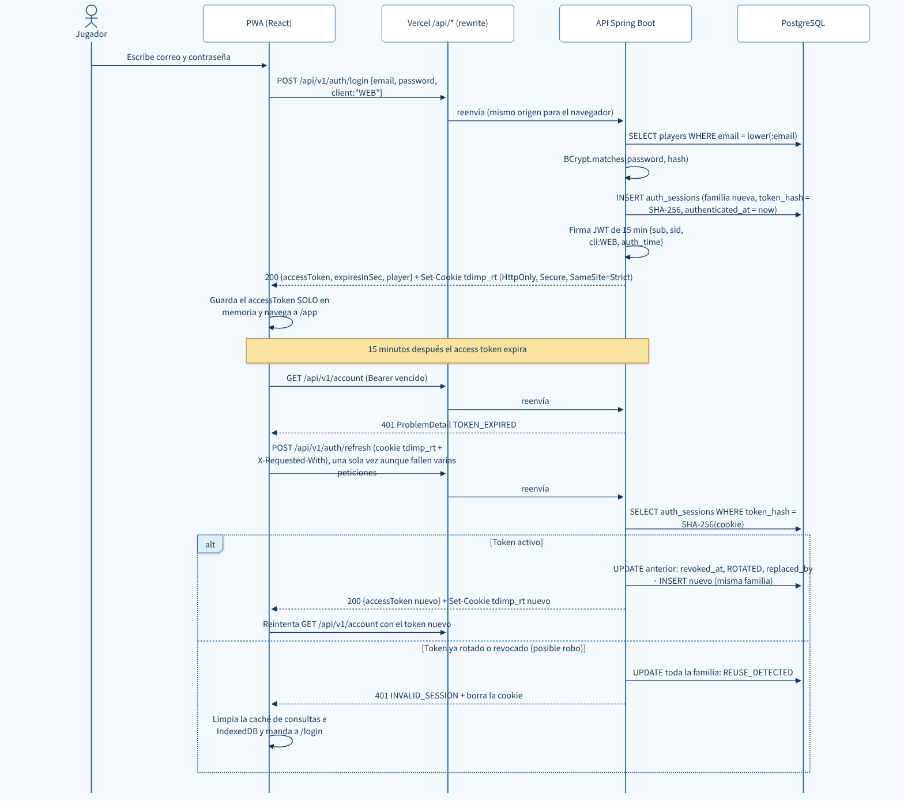

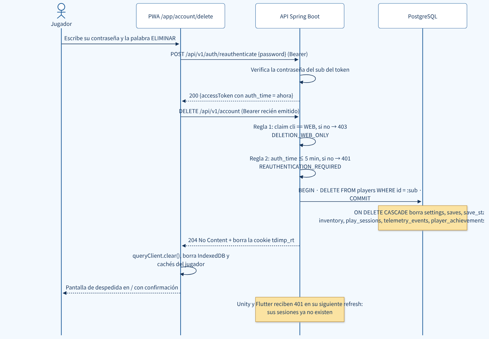

---

## 11. Calidad, pruebas y despliegue

### 11.1 Pruebas automatizadas

| Prueba | Backend | Frontend |
|---|---|---|
| Arquitectura | ArchUnit (§5) | ESLint `no-restricted-imports` |
| Unitarias | JUnit 5 + Mockito + AssertJ sobre los servicios, con dobles de las interfaces y reloj fijo (incluye la práctica de `findAll` y `create`) | Vitest: sesión, `authMiddleware`, reglas del SW, persistencia, esquemas, reintentos |
| Controladores e integración | `@WebMvcTest` · `@SpringBootTest` + MockMvc contra PostgreSQL (`tdimp_test`), cada prueba se revierte | Testing Library + MSW con los ejemplos del contrato: todas las pantallas |
| Accesibilidad y seguridad | — | axe-core, contraste de tokens, movimiento reducido, CSP |
| Cobertura | JaCoCo (`./mvnw verify` → `target/site/jacoco`) | `npm run test:coverage`: 94 % de líneas |
| E2E | Laboratorio de pruebas con Playwright (§11.2) | Laboratorio de pruebas con Playwright (§11.2) |

```bash
cd backend && ./mvnw verify            # unitarias, integración, ArchUnit y JaCoCo
cd frontend && npm run lint && npm run typecheck && npm run test:coverage && npm run build
```

La práctica de pruebas unitarias de `findAll` y `create` con JUnit 5 y Mockito está documentada, con su ejecución y capturas, en [`backend/README.md`](backend/README.md#práctica-pruebas-unitarias-de-findall-y-create).

### 11.2 Laboratorio de pruebas

[`docs/testing/README.md`](docs/testing/README.md) levanta la PWA conectada a Spring Boot y a PostgreSQL y valida la integración completa:

- **Base de datos:** scripts de carga y limpieza (`docs/testing/sql/`), capturas antes y después de los envíos, integridad (restricciones y SQLSTATE) y plan de ejecución.
- **Backend:** 16 casos de API (consultas `GET`, envíos `POST`, creación y consulta del jugador, errores), serie de latencia, métricas de Actuator y el log de Spring Boot con tiempo, consultas, memoria y código de cada petición.
- **PWA:** 9 casos con Playwright sobre las páginas reales: listas renderizadas, detalle, formulario en línea, lectura sin conexión desde Cache Storage, envío encolado en IndexedDB, sincronización al volver la red y registro hasta *Mi cuenta*; además el HAR, la consola y capturas de DevTools (Network, Application, Console).

Las evidencias están en [`docs/testing/evidencias/`](docs/testing/evidencias).

### 11.3 Entornos y despliegue

| Entorno | PWA | API | BD |
|---|---|---|---|
| Local | `npm run dev` (Vite :5173) o `npm run preview` (:4173, con SW) | `./mvnw spring-boot:run` (perfil `local`, :8082) | PostgreSQL local |
| Docker | `docker compose up` (nginx) | Contenedor `eclipse-temurin:21-jre` | Contenedor PostgreSQL 16 |
| Staging | Vercel Preview (rama `dev`) | Render | Supabase |
| Producción | Vercel Production (rama `main`) | Render | Supabase |

GitHub Actions corre las pruebas en cada PR (`ci-backend`, `ci-frontend`, `contract`; son checks obligatorios para fusionar). Vercel despliega la PWA desde Git: `dev` → Preview y `main` → Production. Un tag `vX.Y.Z` en `main` dispara `cd-production`, que valida el tag y despliega la API en Render. Detalle en [`docs/ci/README.md`](docs/ci/README.md). La configuración de Vercel vive en código:

```ts
// frontend/vercel.ts (excerpt) — evaluated on every build
const api = process.env.API_ORIGIN                  // Preview → Render staging, Production → Render production
if (!api) throw new Error('Missing environment variable API_ORIGIN')

export const config: VercelConfig = {
  framework: 'vite',
  rewrites: [
    routes.rewrite('/api/(.*)', `${api}/api/$1`),  // proxy to Render: same origin for the browser
    routes.rewrite('/(.*)', '/index.html'),        // SPA fallback; existing files are served first
  ],
  headers: [
    routes.header('/(.*)', SECURITY_HEADERS),      // CSP and friends on every response
    routes.header('/assets/(.*)', [{ key: 'Cache-Control', value: 'public, max-age=31536000, immutable' }]),
    routes.header('/sw.js', [{ key: 'Cache-Control', value: 'no-cache' }]),   // detect every new SW version
    routes.header('/downloads/(.*).apk', [{ key: 'Content-Type', value: 'application/vnd.android.package-archive' },
                                          { key: 'Content-Disposition', value: 'attachment' }]),
  ],
}
```

El plan gratuito de Render duerme la API tras 15 minutos sin tráfico; la primera petición puede tardar cerca de un minuto en despertarla y mientras tanto la PWA muestra el esqueleto de carga (Vercel espera hasta 120 s al destino, así que la petición no se corta).

---

## 12. Cambios respecto a la propuesta

Las secciones 1 a 11 describen la aplicación como quedó implementada. La propuesta original (octubre de 2026) se conserva en el historial de Git (los primeros commits de este repositorio, PR #1); esta sección registra en qué cambió y por qué, y se actualizó en cada PR que introdujo una diferencia.

### 12.1 Backend

| Aspecto | Propuesta | Implementación | Notas |
|---|---|---|---|
| Autenticación | Spring Security 7 + JWT con Nimbus (`JwtTokenIssuer`, `SecurityConfig` con filtros) | JWT HS256 propio en `service/HmacTokenIssuer` (interfaz `TokenIssuer`) y `controller/BearerAuthInterceptor` para `/api/v1/account/**` y `/auth/reauthenticate` | De Spring Security solo se usa `spring-security-crypto` para el `PasswordEncoder` (BCrypt delegado). Mismo formato de token y mismos claims (`sub`, `sid`, `cli`, `auth_time`, `iat`, `exp`). |
| Persistencia | Spring Data JPA + `JdbcClient` · MapStruct | Solo `JdbcClient`: cada repositorio es una interfaz con su implementación `*Jdbc`; la conversión `model` ↔ `dto` la hacen los services (`SaveMapper` y métodos `from`) | Sin entidades JPA, sin Hibernate y sin MapStruct; Flyway sigue siendo el único que modifica el esquema. |
| Paquetes | `security/` aparte y un controlador por recurso (`SettingsController`, `DeviceController`, `HistoryController`, …) | Lo de seguridad vive en `service/` (tokens) y `controller/` (interceptor y canales del refresh token); `AccountController` agrupa `/account/**` excepto partidas (`SaveController`) | Las capas y sus reglas de ArchUnit son las mismas. |
| Jugador de la petición | `Requester` resuelto por `RequesterResolver` | `AccessClaims` resuelto por `CurrentPlayerResolver` | El id del jugador sigue saliendo siempre del token. |
| Reloj | `ClockConfig` | `ClockConfig` inyectado en todos los services y en `HmacTokenIssuer` | Las pruebas usan `Clock.fixed` para probar vencimientos sin esperar. |
| Documentación de la API | springdoc genera `/v3/api-docs` | No se usa springdoc | `docs/api/openapi.yaml` es la única fuente de verdad; de él se generan los tipos del frontend y `contract.yml` lo valida. |
| Límite de intentos | `RateLimiter` con Bucket4j · `NoOpRateLimiter` en pruebas | `RateLimiter` con `InMemoryRateLimiter` (ventana fija en memoria, sin dependencias) y `NoOpRateLimiter` cuando `tdimp.rate-limit.enabled=false` (perfil `test`) | Login: 5 por IP + correo cada 15 min (un login correcto reinicia); registro: 10 por IP cada hora; reautenticación: 5 por jugador cada 15 min; aviso de lanzamiento: 10 por IP cada hora. Se ajusta en `tdimp.rate-limit.*`. Responde 429 `TOO_MANY_ATTEMPTS` con `Retry-After`. Al estar en memoria, cuenta por instancia: con más de una instancia de la API habría que moverlo a la base de datos o a Redis. |

### 12.2 Frontend

| Aspecto | Propuesta | Implementación | Notas |
|---|---|---|---|
| Sesión en memoria | `shared/auth/tokenStore.ts` (`TokenStore`) | `shared/auth/session.ts` y `authMiddleware.ts` | Mismo comportamiento: el access token solo vive en memoria. |
| Pantalla `/lab` | No estaba en la propuesta | Diagnóstico del laboratorio de pruebas; solo existe en `npm run dev` | En `npm run build` no se monta la ruta ni se genera su chunk. |
| Claves de las consultas del jugador | `['saves']`, `['history', { type }]`, `['sessions', { slot }]`, `['achievements']` (§7.5) | `['account', 'saves']`, `['account', 'history', { type }]`, `['account', 'sessions', { slot }]`, `['account', 'achievements']` | Al cerrar sesión se borra todo lo que empieza con `'account'`; así ningún dato de un jugador queda en caché para el siguiente. El catálogo público sigue en `['achievements', 'catalog']`. `src/app/queryKeys.test.ts` lo comprueba. |
| Filtro del historial | Se muestra junto con la lista (§7.5) | Se muestra en todos los estados (cargando, error, vacío) | Si un filtro no tiene registros, el jugador puede cambiarlo sin recargar. |
| Dueño de los datos guardados | `buster: playerId ?? 'anonymous'` (§8.5) | Persister propio con `idb-keyval` (`shared/query/persister.ts`) que marca cada copia con el id del jugador; la sesión guardada (`tdimp.offline-session` en `localStorage`, sin tokens) dice de quién es | `PersistQueryClientProvider` no vuelve a leer `buster` cuando cambia la sesión; marcar cada copia evita que un jugador vea la caché de otro. Una copia sin consultas borra la entrada, así que al cerrar sesión IndexedDB queda vacío. |
| Qué se guarda sin conexión | Resumen, partidas, 1.ª página del historial, logros y configuración | Lo mismo, más el detalle de cada partida y la actividad reciente del resumen; del historial sin filtro se guardan las páginas ya cargadas | Así `/app` y `/app/saves/:slot` abren completos sin red. Un historial filtrado necesita conexión. |
| Cuándo entra el modo lectura | `refresh()` responde `OFFLINE` | Sin red **o** con la API caída (5xx) en el refresh, si hay sesión guardada. Los botones que escriben también se desactivan si el navegador pierde la red con la sesión abierta (`useReadOnly`) | Lo guardado gana a una consulta que falló sin red: las pantallas muestran los datos y no el error. Lo que no se guardó dice que aparecerá al volver la conexión. |
| Botón "Instalar app" | En el panel y en el pie de la landing (§8.7) | En la navegación del panel y en la sección "Descarga la demo" de la landing | Mismo comportamiento: Chrome/Edge/Android abren el diálogo; iOS muestra los pasos; instalada, no aparece. |
| Manifiesto | En `vite.config.ts` (§8.1) | `src/shared/pwa/manifest.ts`, importado por `vite.config.ts`; los atajos llevan ícono y `?source=shortcut`; capturas `wide` (1280×720) y `narrow` (390×844) de la landing en `public/screenshots/` | Las pruebas comprueban que cada atajo abre una pantalla que existe y que las capturas existen. Las capturas son webp para que no entren al precache. |
| Reglas del Service Worker | En `src/sw.ts` (§8.3) | Las decisiones (qué se cachea, qué se encola, cómo se reenvía la cola) viven en `src/shared/pwa/swRules.ts`; `sw.ts` solo las conecta con Workbox | Así se prueban sin un worker real (`swRules.test.ts`). La caché `public-api` ahora acepta exactamente `/api/v1/news`, `/api/v1/news/{slug}` y `/api/v1/achievements` (antes cualquier ruta que empezara con `/api/v1/news`). |
| Dirección de arte (§9.2, §9.3) | Tema Tsuki con colores planos | Islas flotantes en tonos pastel, vidrio rosa/morado (`.glass`), arte pixel del juego, tipografías Cinzel (títulos), Plus Jakarta Sans (texto) y Pixelify Sans (detalles); tema claro y oscuro con tokens en `shared/styles/tokens.css` | Todo con CSS Modules. El arte se sirve en webp a dos anchos (`pair()` en `shared/ui/art.ts`) con `srcSet`. |
| Sitio del estudio | Solo la landing y las noticias | `/nosotros` (Sobre Hex Studio, equipo y roles), `/privacidad`, `/cookies` y pie corporativo con enlaces legales | Datos de la empresa ficticios para el proyecto escolar. |
| Contenido del juego en la landing | Textos de ejemplo | Material real del build: leyenda en 6 viñetas, galería de 8 capturas en una cuadrícula pareja de 4×2 con visor (`<dialog>`, flechas del teclado); Kaede como investigadora y Varn, el Guardián del Umbral, en los textos de "Cómo se juega" | El índice del hero (01 historia, 02 galería, 03 descarga) y la ficha "Mira cómo se ve" llevan a sus secciones. Sin video en el repo: las capturas se sacaron de grabaciones del juego y **solo** aparecen en la galería; "Cómo se juega", el hero y las portadas de noticias usan las ilustraciones. |
| Llamada a la acción | "Comprar" | "Descargar demo": enlace a `github.com/Sidas200/integradora/releases/latest` con requisitos (Windows 10 u 11 de 64 bits, DirectX 11 o 12, 600 MB, teclado y mouse) | La URL vive en `features/landing/config.ts` junto con la de la app móvil. |
| Portadas de noticias | Una imagen por slug | `coverOf(slug, coverKey)` en `features/news/covers.ts`: usa el `coverKey` que manda la API y, si no viene, cae al slug; todas son ilustraciones del juego, no capturas | Varias noticias pueden compartir portada sin duplicar archivos. |
| App móvil | Enlace a los releases del repositorio móvil | El APK se sirve desde el propio sitio: `frontend/public/downloads/tdimp-mobile.apk` (48 MB), enlazado desde la sección "Tu partida, en tu bolsillo" y el pie con `download` | Nombre fijo: una versión nueva reemplaza el archivo y los enlaces no cambian. Vercel y nginx lo mandan como `application/vnd.android.package-archive` y `attachment`; el Service Worker no lo intercepta ni lo precachea. |
| SEO | No definido | `public/robots.txt` permite todo menos `/app` | Sin `sitemap.xml` hasta tener dominio definitivo. |

### 12.3 Calidad y despliegue

| Aspecto | Propuesta | Implementación | Notas |
|---|---|---|---|
| Pruebas de integración del backend | `@WebMvcTest` · `@DataJpaTest` contra PostgreSQL | `@SpringBootTest` + MockMvc contra PostgreSQL (`*IntegrationTest`), con `@Transactional` para deshacer cada prueba; helpers en `test/.../support/ApiTestClient` | `@WebMvcTest` se mantiene para controladores aislados. |
| Cobertura | No definida | JaCoCo en `./mvnw verify` (`target/site/jacoco`) y `npm run test:coverage` (`frontend/coverage`) | CI publica los reportes como artefactos `backend-test-reports` y `web-coverage`. |
| Pruebas unitarias del frontend | Pantallas con Vitest + MSW (§11) | Además de las pantallas: sesión y `authMiddleware`, reglas del Service Worker, registro del SW y componentes PWA, persistencia en IndexedDB, esquemas zod, política de reintentos, layouts y errores de ruta | `fake-indexeddb` da IndexedDB en jsdom; `virtual:pwa-register` se sustituye por `src/test/virtualPwaRegister.ts`. |
| CSP (§10) | Política estricta | `Content-Security-Policy` igual en `frontend/vercel.ts` (todas las rutas) y en `frontend/nginx/default.conf.template` (repetida en los `location` que fijan sus propios encabezados), más `nosniff`, `Referrer-Policy` y `Permissions-Policy` | Solo `'self'`; `style-src` permite `'unsafe-inline'` por los estilos en línea de React. Sin `upgrade-insecure-requests` para que Docker funcione en `http://localhost`. `src/app/csp.test.ts` comprueba que ambas políticas sean iguales y estrictas. |
| Accesibilidad | `cypress-axe` en las E2E (§11) | `axe-core` dentro de Vitest (`src/app/a11y.test.tsx`) sobre las rutas públicas, el 404 y el panel con sesión; contraste ≥ 4.5:1 de los tokens en claro y oscuro; movimiento reducido en `global.css` y en las animaciones ligadas al scroll | jsdom no calcula contraste real, por eso se mide desde los tokens. |
| Docker | Sin Docker en los equipos | `docker-compose.yml` y Dockerfiles para levantar la API, la PWA y PostgreSQL juntos | Opcional; el desarrollo diario sigue con PostgreSQL local. |
| Pruebas E2E | Cypress + `cypress-axe` contra staging (§11) | Laboratorio de pruebas con Playwright (`frontend/scripts/lab-evidence.mjs`) contra la API y la PWA locales: 16 casos de API y 9 de la PWA, incluido el modo sin conexión y Background Sync | Playwright permite cortar la red del Service Worker por CDP y disparar el evento `sync`, que Cypress no controla. El paso de humo con Cypress de `reusable-deploy.yml` queda listo y se omite con un aviso mientras no exista `frontend/cypress/e2e/smoke`. |
| Laboratorio de pruebas | No definido | [`docs/testing/`](docs/testing/README.md): scripts de carga y limpieza, casos de base de datos, API y PWA, evidencias de DevTools, pgAdmin y logs de Spring Boot | Lo pide la materia; se corre antes de cada entrega. |

### 12.4 Pendiente de implementar

Lo que la propuesta describe y todavía no existe en el código. Se quita de esta lista en el PR que lo implementa.

- Nada de la propuesta queda pendiente. Lo que cambió de forma está en las tablas anteriores (por ejemplo, las pruebas E2E con Cypress se reemplazaron por el laboratorio con Playwright).
