# The Day I Made That Promise · PWA

**Propuesta de arquitectura e interfaz de la aplicación web progresiva.**

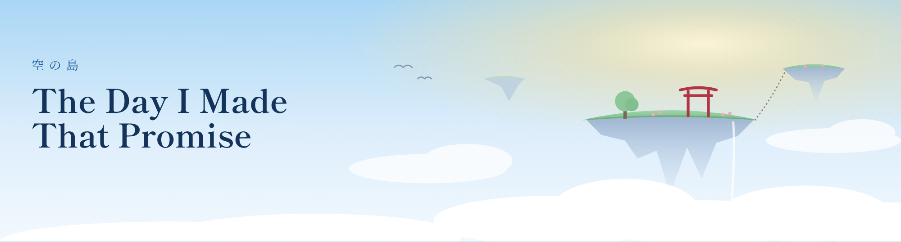

Aplicación web progresiva que presenta el juego, administra la cuenta del jugador y muestra su progreso guardado en la nube. Este documento define su arquitectura, las interfaces entre sus componentes, el consumo de la API, la estrategia PWA y el diseño de la experiencia de usuario.

**Equipo Hex Studio:** Jáuregui Iracheta Víctor Yahir · Medellín Salcedo Santiago · Molina Reza Omar Gael · Ramos Juárez Brenda Regina · Rodríguez González Emmanuel · Sidas Rodríguez Pedro Arturo

---

## Índice

1. [Resumen](#1-resumen)
2. [Alcance](#2-alcance)
3. [Stack tecnológico](#3-stack-tecnológico)
4. [Arquitectura](#4-arquitectura)
5. [Interfaces](#5-interfaces)
6. [Base de datos](#6-base-de-datos)
7. [Consumo de API](#7-consumo-de-api)
8. [Estrategia PWA](#8-estrategia-pwa)
9. [Experiencia de usuario (UI/UX)](#9-experiencia-de-usuario-uiux)
10. [Seguridad y sesiones](#10-seguridad-y-sesiones)
11. [Calidad y despliegue](#11-calidad-y-despliegue)

---

## 1. Resumen

- **Qué es:** una PWA instalable que presenta y vende el juego, permite crear y administrar la cuenta del jugador y muestra su progreso guardado en la nube (partidas, historial y logros).
- **Clientes de la API:** la PWA, el juego en Unity (PC) y la app móvil en Flutter. Ninguno habla con la base de datos; solo la API.
- **Stack:** **React 19 + TypeScript sobre Vite 8** en el frontend, **Spring Boot 4.1 con Java 21** en N-capas en el backend y **PostgreSQL** (Supabase) como base de datos.
- **Consumo de API:** listas paginadas que se piden con un cliente tipado desde el contrato OpenAPI, se guardan en caché y se pintan con cuatro estados (cargando, error, vacía, con datos).
- **Estrategia PWA:** manifiesto con íconos *maskable* y atajos, Service Worker propio (Workbox) con precache, caché de la API pública, cola en segundo plano (*Background Sync*) y actualización controlada por el usuario; datos del jugador disponibles sin conexión.
- **UI/UX:** módulos por funcionalidad en TypeScript, CSS Modules con tokens de diseño y diseño adaptativo *mobile first*.
- **Idioma del código:** todo en inglés (carpetas, archivos, clases, rutas, tablas, JSON, comentarios). Los textos que ve el jugador están en español.

---

## 2. Alcance

### 2.1 Funcionalidades

| Funcionalidad | Módulo del frontend |
|---|---|
| Landing con historia, bucle, personajes, ficha técnica y compra | `landing` |
| Noticias (lista paginada y detalle) leídas de la API | `news` |
| Aviso de lanzamiento con envío en segundo plano | `landing` |
| Registro, inicio y cierre de sesión | `auth` |
| Resumen, partidas, historial y logros | `dashboard`, `saves`, `history`, `achievements` |
| Cambiar nombre de usuario, contraseña y configuración del juego | `account` |
| Ver y cerrar sesiones en otros dispositivos | `account` |
| Eliminar cuenta (solo web, con reautenticación) | `account` |
| Instalación, modo sin conexión y aviso de actualización | `shared/pwa` |

### 2.2 Casos de uso y CRUD

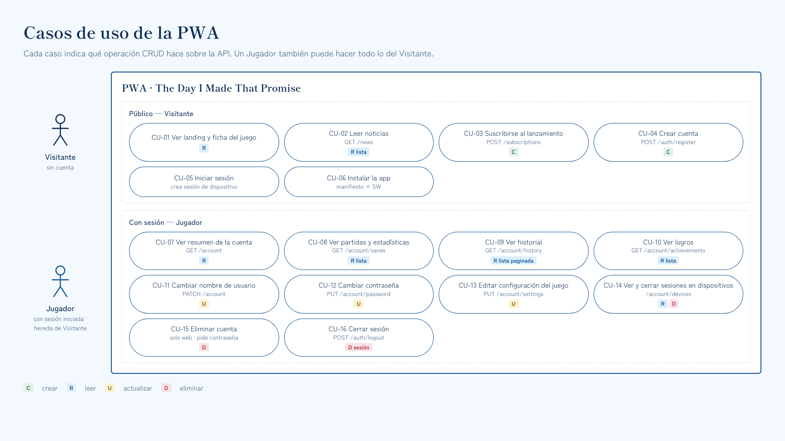

| Entidad | Create | Read | Update | Delete |
|---|---|---|---|---|
| Cuenta (`players`) | Registro (web o móvil) | Perfil y resumen | Nombre de usuario, contraseña | Eliminar cuenta (**solo web**) |
| Configuración (`settings`) | Al registrarse | Sí | Volumen, idioma, pantalla completa, controles | En cascada con la cuenta |
| Sesiones de dispositivo (`auth_sessions`) | Al iniciar sesión | Lista de dispositivos | Rotación del token | Cerrar uno o todos los demás |
| Partidas (`saves`) | Desde el juego | Ranuras y detalle | Desde el juego | En cascada con la cuenta |
| Historial (`play_sessions`, logros, hitos) | Desde el juego | Lista paginada | — | En cascada con la cuenta |
| Noticias (`news_posts`) | Migración Flyway | Lista paginada y detalle | Migración Flyway | Migración Flyway |
| Aviso de lanzamiento (`launch_subscriptions`) | Formulario público | — | — | — |

---

## 3. Stack tecnológico

| Capa | Tecnología | Para qué |
|---|---|---|
| Frontend | **React 19.3** + **TypeScript 5.9** sobre **Node.js 24** | Componentes declarativos con tipos |
| Empaquetador | **Vite 8** + `@vitejs/plugin-react` | Servidor de desarrollo, build optimizado y *code splitting* por ruta |
| Rutas | **React Router 8** (modo *data*, rutas `lazy`) | Rutas anidadas con layout privado y carga diferida |
| Datos del servidor | **TanStack Query 5** + persistencia en IndexedDB (`idb-keyval`) | Caché, paginación, reintentos y datos sin conexión |
| Cliente HTTP | **openapi-fetch** + tipos de **openapi-typescript** | Llamadas tipadas a partir del contrato |
| Formularios | **React Hook Form** + **Zod** | Validación declarativa igual a la del backend |
| PWA | **vite-plugin-pwa** (Workbox 7, estrategia `injectManifest`) | Manifiesto, precache y Service Worker propio |
| Estilos y textos | **CSS Modules** + tokens CSS · **react-i18next** (`es.json`) | CSS modular por componente; textos fuera del código |
| Backend | **Spring Boot 4.1** con **Java 21 LTS**, Maven | API REST en N-capas |
| Seguridad | Spring Security 7 + JWT (Nimbus) + BCrypt | Sesiones con access y refresh token |
| Persistencia | Spring Data JPA + `JdbcClient` · **Flyway** · MapStruct | Entidades, consultas de listas y migraciones versionadas |
| Contrato | **OpenAPI 3.1** (`docs/api/openapi.yaml`) + springdoc | Fuente de verdad de la API |
| Base de datos | **PostgreSQL** en Supabase (esquema `game`) | Datos de cuentas, partidas e historial |
| Despliegue | **Vercel** (PWA) · **Render** (API) · GitHub Actions | CDN, API y CI/CD en planes gratuitos |
| Pruebas | Vitest, Testing Library, MSW, Cypress · JUnit, Mockito, ArchUnit | Unitarias, integración, E2E y reglas de arquitectura |

---

## 4. Arquitectura

### 4.1 Contexto

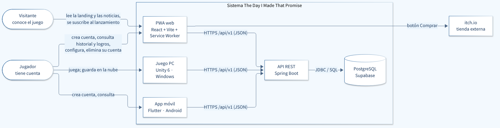

### 4.2 Despliegue

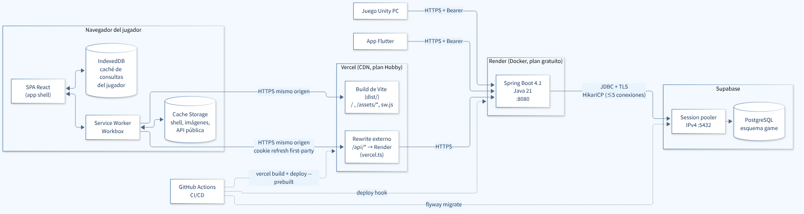

- **La PWA llama a `/api/*` en su propio dominio y Vercel lo reenvía a Render** (rewrite a un origen externo). Así la cookie de sesión es *first-party* y no hace falta CORS. En desarrollo, el proxy de Vite hace lo mismo (`/api` → `localhost:8080`).
- Unity y Flutter llaman directo a Render con `Authorization: Bearer`.
- La API se conecta a PostgreSQL por el *session pooler* de Supabase con un rol que solo puede leer y escribir filas.

### 4.3 Backend en N-capas

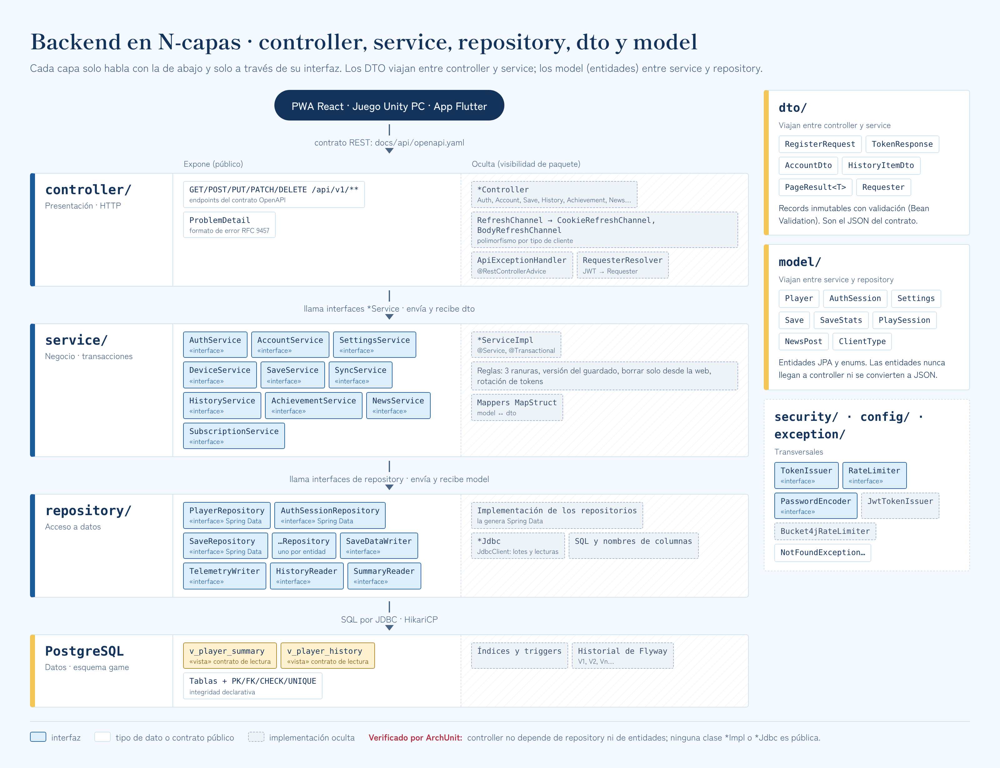

El backend se divide en las capas vistas en clase. Cada capa solo llama a la de abajo y solo a través de su **interfaz**:

| Paquete | Capa | Responsabilidad | Usa |
|---|---|---|---|
| `controller` | Presentación | Rutas HTTP, validación de entrada, JWT → `Requester`, errores → `ProblemDetail` | `service`, `dto` |
| `service` | Negocio | Reglas, transacciones y conversión `model` ↔ `dto` | `repository`, `model`, `dto` |
| `repository` | Acceso a datos | Consultas y escrituras en PostgreSQL | `model` |
| `dto` | Transferencia | *Records* que entran y salen por la API (el JSON del contrato) | — |
| `model` | Dominio | Entidades JPA y enums | — |
| `security`, `exception`, `config` | Transversales | Tokens, límite de intentos, excepciones y propiedades | — |

```text
backend/src/main/java/mx/utch/tdimp/api/
├── TdimpApiApplication.java
├── controller/   AuthController, AccountController, SettingsController, DeviceController, SaveController,
│                 SaveDataController, TelemetryController, HistoryController, AchievementController,
│                 NewsController, SubscriptionController · RefreshChannel «interface» + CookieRefreshChannel,
│                 BodyRefreshChannel · RequesterResolver · ApiExceptionHandler
├── service/      AuthService, AccountService, SettingsService, DeviceService, SaveService, SyncService,
│                 HistoryService, AchievementService, NewsService, SubscriptionService «interfaces» + *ServiceImpl
├── repository/   PlayerRepository, AuthSessionRepository, SaveRepository, ... «Spring Data interfaces»
│                 SaveDataWriter, TelemetryWriter, HistoryReader, SummaryReader «interfaces» + *Jdbc
├── dto/          RegisterRequest, LoginRequest, TokenResponse, AccountDto, SaveSummaryDto, HistoryItemDto,
│                 PageResult<T>, PageQuery, Requester, ... (records)
├── model/        Player, AuthSession, Settings, Save, SaveStats, InventoryItem, PlaySession, TelemetryEvent,
│                 PlayerAchievement, NewsPost, LaunchSubscription, catalogs · ClientType, Character (enums)
├── security/     TokenIssuer, RateLimiter «interfaces» + JwtTokenIssuer, Bucket4jRateLimiter · SecurityConfig
├── exception/    NotFoundException, VersionConflictException, DuplicateValueException, InvalidSessionException, ...
└── config/       TdimpProperties (@ConfigurationProperties) · ClockConfig
```

**Una petición atravesando las capas** (listar el historial):

```java
// controller/HistoryController.java
@RestController
@RequestMapping("/api/v1/account/history")
@RequiredArgsConstructor
class HistoryController {
  private final HistoryService history;                             // service interface

  @GetMapping
  PageResult<HistoryItemDto> list(Requester requester,              // built by RequesterResolver from the JWT
                                  @RequestParam(required = false) HistoryType type,
                                  @RequestParam(defaultValue = "0") @Min(0) int page,
                                  @RequestParam(defaultValue = "20") @Min(1) @Max(50) int size) {
    return history.list(requester, type, new PageQuery(page, size));
  }
}

// service/HistoryService.java — the contract the controller depends on
public interface HistoryService {
  PageResult<HistoryItemDto> list(Requester requester, HistoryType type, PageQuery page);
}

// service/HistoryServiceImpl.java — hidden implementation (package-private)
@Service
@RequiredArgsConstructor
class HistoryServiceImpl implements HistoryService {
  private final HistoryReader reader;                               // repository interface

  @Override
  @Transactional(readOnly = true)
  public PageResult<HistoryItemDto> list(Requester requester, HistoryType type, PageQuery page) {
    var query = new HistoryQuery(requester.playerId(), type, page.size(), page.offset());
    var content = reader.find(query).stream().map(HistoryItemDto::from).toList();
    return PageResult.of(content, page, reader.count(query));
  }
}

// repository/HistoryReader.java — implemented by HistoryReaderJdbc over the v_player_history view
public interface HistoryReader {
  List<HistoryRow> find(HistoryQuery query);
  long count(HistoryQuery query);
}
```

- El id del jugador **siempre sale del token**, nunca de la URL: las rutas privadas son `/account/...`, así nadie puede pedir datos de otro.
- Las **entidades de `model` nunca llegan a `controller`** ni se convierten a JSON; la API solo devuelve `dto`.

### 4.4 Frontend modular

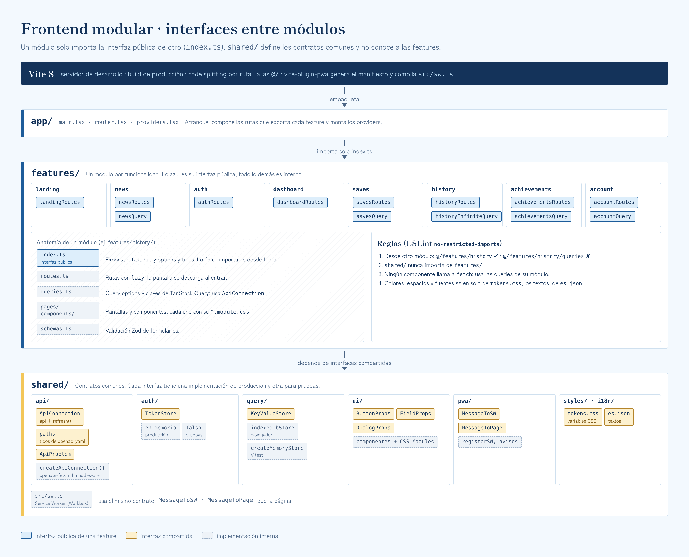

```text
frontend/
├── index.html · vite.config.ts · vercel.ts · eslint.config.js
├── public/                    robots.txt, favicon.svg, generated icons, landing art
└── src/
    ├── main.tsx · sw.ts       app entry point · Service Worker (§8.3)
    ├── app/                   router.tsx, providers.tsx, PublicLayout, AppLayout
    ├── features/              one module per feature, each one with index.ts (public interface)
    │   ├── landing/ · news/ · auth/ · dashboard/ · saves/ · achievements/ · account/
    │   └── history/           index.ts · routes.ts · queries.ts · pages/HistoryPage · components/ (TypeFilter, Timeline)
    ├── shared/                nothing here imports from features/
    │   ├── api/               client.ts (ApiConnection) · schema.d.ts (generated) · problems.ts
    │   ├── auth/              tokenStore.ts · AuthProvider · RequireAuth · offlineSession.ts
    │   ├── query/             queryClient.ts · persistence.ts
    │   ├── pwa/               messages.ts · registerSW.ts · UpdatePrompt · InstallButton · OfflineBanner
    │   ├── ui/                Button, Field, Dialog, Skeleton, EmptyState, ErrorState
    │   ├── i18n/              es.json
    │   └── styles/            tokens.css · reset.css · global.css
    └── test/                  setup.ts · msw/handlers.ts
```

La estructura modular se explica en [§9.2](#92-estructura-modular-en-javascript-y-css).

### 4.5 Repositorio

Hoy el repositorio contiene la propuesta (`README.md`, `SUBMISSION.md` y `docs/`); `backend/`, `frontend/` y `.github/` son la estructura planeada para la implementación.

```text
integradora-web/
├── README.md · SUBMISSION.md
├── .github/workflows/      ci-backend.yml · ci-frontend.yml · contract.yml · cd-staging.yml · cd-production.yml
├── backend/                Spring Boot (§4.3)
├── frontend/               React + Vite (§4.4)
└── docs/
    ├── api/openapi.yaml    API contract
    ├── db/                 V1__initial_schema.sql · V2__initial_data.sql · app_role.sql · verify_schema.sql
    ├── diagrams/           Mermaid sources (.mmd) + mermaid.config.json
    ├── design/             tokens.css · contrast.py · icon.svg · boards/*.html
    └── img/                exported diagrams, banner and style sheet (PNG)
```

---

## 5. Interfaces

Una **interfaz** es el contrato que dice **qué** ofrece un componente sin revelar **cómo** lo hace. Quien consume depende del contrato, nunca de la implementación; así una pieza se cambia sin tocar a las demás (acoplamiento débil), varias implementaciones conviven (polimorfismo) y cada una se sustituye por un doble en las pruebas.

| Nivel | Interfaz (qué) | Implementación (cómo) | La usa |
|---|---|---|---|
| Entre sistemas | API REST [`docs/api/openapi.yaml`](docs/api/openapi.yaml) | Controladores de Spring Boot | PWA, Unity, Flutter |
| Entre capas del backend | `*Service` · `*Repository`, `*Reader`, `*Writer` | `*ServiceImpl` · Spring Data, `*Jdbc` | La capa de arriba |
| Servicios técnicos | `TokenIssuer`, `RateLimiter`, `PasswordEncoder`, `RefreshChannel` | Una o más por contrato (tabla siguiente) | `service`, `controller` |
| Entre módulos del frontend | `index.ts` de cada feature | Pantallas, componentes y queries internos | Router y otras features |
| Contratos del frontend | `ApiConnection`, `TokenStore`, `KeyValueStore`, `ButtonProps`, `MessageToSW` / `MessageToPage` | Implementaciones en `shared/` | Features y Service Worker |
| Base de datos | Vistas `v_player_summary`, `v_player_history` | Tablas e índices | `repository` |

**Polimorfismo:** varias implementaciones del mismo contrato.

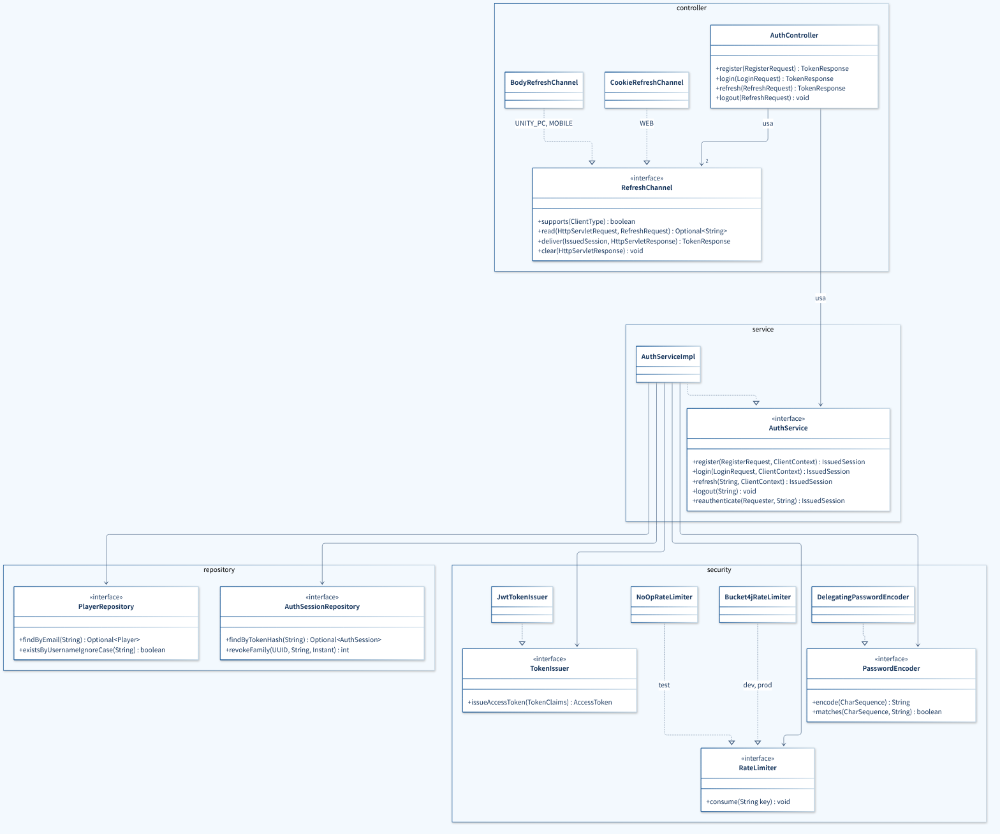

| Interfaz | Implementaciones | Qué se gana |
|---|---|---|
| `RefreshChannel` | `CookieRefreshChannel` (WEB) · `BodyRefreshChannel` (UNITY_PC, MOBILE) | Un solo `AuthController` entrega el refresh token en cookie al navegador y en JSON a los clientes nativos |
| `PasswordEncoder` | `DelegatingPasswordEncoder` → BCrypt | Cambiar a Argon2 sin migrar cuentas |
| `RateLimiter` | `Bucket4jRateLimiter` · `NoOpRateLimiter` (pruebas) | Las pruebas no se bloquean por el límite de intentos |
| `KeyValueStore` (frontend) | `indexedDbStore` · `createMemoryStore()` | La misma persistencia funciona en el navegador y en Vitest |

**Las reglas de capas se verifican en cada build** con ArchUnit; si alguien las rompe, el build falla:

```java
// test/.../ArchitectureTest.java
@ArchTest
static final ArchRule layers = layeredArchitecture().consideringOnlyDependenciesInLayers()
    .layer("Controller").definedBy("..controller..")
    .layer("Service").definedBy("..service..")
    .layer("Repository").definedBy("..repository..")
    .whereLayer("Controller").mayNotBeAccessedByAnyLayer()
    .whereLayer("Service").mayOnlyBeAccessedByLayers("Controller")
    .whereLayer("Repository").mayOnlyBeAccessedByLayers("Service");

@ArchTest
static final ArchRule controllersNeverSeeEntities = noClasses().that().resideInAPackage("..controller..")
    .should().dependOnClassesThat().areAnnotatedWith(Entity.class);

@ArchTest
static final ArchRule implementationsAreHidden = classes()
    .that().haveSimpleNameEndingWith("Impl").or().haveSimpleNameEndingWith("Jdbc")
    .should().notBePublic();
```

---

## 6. Base de datos

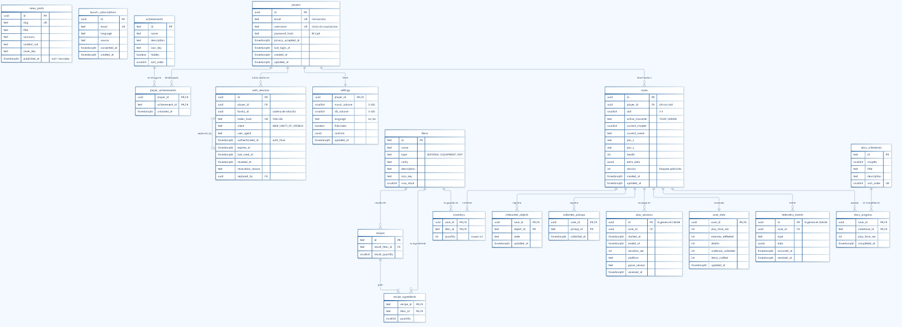

Scripts listos para Flyway en [`docs/db/`](docs/db), probados en PostgreSQL 16 con [`verify_schema.sql`](docs/db/verify_schema.sql) (restricciones, vistas, cascadas e idempotencia):

| Script | Contenido |
|---|---|
| [`V1__initial_schema.sql`](docs/db/V1__initial_schema.sql) | 19 tablas, 2 vistas, índices y triggers de `updated_at` |
| [`V2__initial_data.sql`](docs/db/V2__initial_data.sql) | Catálogos (items, receta, logros, hitos) y dos noticias |
| [`app_role.sql`](docs/db/app_role.sql) | Rol `tdimp_app` de la API, solo con permisos de lectura y escritura de filas |
| [`verify_schema.sql`](docs/db/verify_schema.sql) | Aserciones; corre en una transacción que se revierte |

| Grupo | Tablas |
|---|---|
| Cuenta y sesiones | `players`, `auth_sessions` (refresh tokens hasheados), `settings` |
| Partidas | `saves` (ranuras 1–3 con `version`), `save_stats`, `inventory`, `collected_pickups`, `interacted_objects`, `story_progress` |
| Historial y logros | `play_sessions`, `telemetry_events`, `player_achievements` |
| Catálogos | `items`, `recipes`, `recipe_ingredients`, `achievements`, `story_milestones` |
| Contenido público | `news_posts`, `launch_subscriptions` |
| Vistas de lectura | `v_player_summary` (resumen de la cuenta) · `v_player_history` (sesiones, logros e hitos en una línea de tiempo) |

**Convenciones:** tablas y columnas en inglés y `snake_case`; `created_at` / `updated_at` en UTC; integridad con PK, FK, `CHECK` y `UNIQUE`; eliminar una cuenta borra sus datos en cascada. Los textos que ve el jugador (nombres de logros, noticias) se guardan en español.

---

## 7. Consumo de API

La PWA recupera listas de datos de endpoints remotos y las pinta dinámicamente. El contrato completo está en [`docs/api/openapi.yaml`](docs/api/openapi.yaml) (OpenAPI 3.1); de él se generan los tipos de TypeScript, así que si un endpoint cambia, el compilador marca cada uso roto.

### 7.1 Convenciones

| Tema | Regla |
|---|---|
| Base | `/api/v1`, JSON en `camelCase`, fechas ISO-8601 en UTC |
| Listas paginadas | `?page=0&size=20` (máx. 50) → `{ "content": [...], "page": { "number", "size", "totalElements", "totalPages" } }` |
| Errores | `application/problem+json` (RFC 9457) con un `code` estable; la PWA muestra su propio texto según el `code` |
| Caché HTTP | Datos privados: `no-store`. Noticias: `public, max-age=300`. Catálogo de logros: `public, max-age=3600` |

### 7.2 Endpoints

| Método y ruta | Devuelve | Auth | Lo usa |
|---|---|---|---|
| `POST /auth/register` · `/auth/login` · `/auth/refresh` · `/auth/logout` | Tokens / 204 | — | Todos los clientes |
| `POST /auth/reauthenticate` | Token reciente | Bearer | PWA (antes de eliminar) |
| `GET` · `PATCH` · `DELETE /account` | Cuenta y resumen | Bearer | `DELETE` solo PWA |
| `PUT /account/password` · `GET`/`PUT /account/settings` | — / configuración | Bearer | PWA, juego, móvil |
| `GET /account/devices` · `DELETE /account/devices[/{id}]` | **Lista** de dispositivos | Bearer | PWA |
| `GET /account/saves` · `GET /account/saves/{slot}` | **Lista** de ranuras · detalle | Bearer | PWA, móvil |
| `GET /account/history?type=` | **Lista paginada** de la línea de tiempo | Bearer | PWA |
| `GET /account/sessions?slot=` | **Lista paginada** de sesiones de juego | Bearer | PWA |
| `GET /account/achievements` | **Lista** de logros con estado | Bearer | PWA, móvil |
| `GET /news` · `GET /news/{slug}` | **Lista paginada** · detalle | — | PWA |
| `GET /achievements` | **Lista** del catálogo | — | PWA |
| `POST /subscriptions` | 202 | — | PWA (landing) |
| `GET`/`PUT /account/saves/{slot}/data` · `POST .../sessions` · `POST .../events` · `PUT /account/achievements/{id}` | Guardado y telemetría | Bearer | Juego Unity |

### 7.3 JSON de ejemplo

**Lista paginada** · `GET /account/history?page=0&size=20`
```json
{
  "content": [
    { "type": "ACHIEVEMENT", "referenceId": "first_craft", "occurredAt": "2026-10-10T01:53:00Z", "slot": null, "title": "El poder se fabrica", "valueSec": null },
    { "type": "SESSION", "referenceId": "0b9d6a52-1d0e-4a51-8f6e-2c4b7e9a1f30", "occurredAt": "2026-10-10T01:58:00Z", "slot": 1, "title": null, "valueSec": 1680 },
    { "type": "MILESTONE", "referenceId": "zone1_shrine", "occurredAt": "2026-10-10T01:10:00Z", "slot": 1, "title": "Primer santuario", "valueSec": 5400 }
  ],
  "page": { "number": 0, "size": 20, "totalElements": 3, "totalPages": 1 }
}
```

**Lista sin paginar** · `GET /account/achievements` (los logros ocultos y bloqueados llegan enmascarados)
```json
[
  { "id": "first_craft", "name": "El poder se fabrica", "description": "Fabrica tu primer objeto en la forja.",
    "iconKey": "achievement_forge", "hidden": false, "sortOrder": 20, "unlocked": true, "unlockedAt": "2026-10-10T01:53:00Z" },
  { "id": "rulebreaker", "name": "Logro oculto", "description": null,
    "iconKey": null, "hidden": true, "sortOrder": 50, "unlocked": false, "unlockedAt": null }
]
```

**Petición de la PWA** · `POST /auth/register` (en web el refresh token vuelve en una cookie `HttpOnly`, nunca en el JSON)
```json
{ "email": "felc@example.com", "username": "Felc", "password": "a-long-passphrase", "acceptedPrivacyNotice": true, "client": "WEB" }
```

**Documento que produce el juego** · `PUT /account/saves/{slot}/data` (la API lo reparte en tablas; `version` evita que dos computadoras se pisen el avance)
```json
{
  "version": 7, "activeCharacter": "TSUKI", "currentChapter": 1, "currentScene": "Zone1_Forest",
  "stats": { "playTimeSec": 6720, "enemiesDefeated": 61, "deaths": 3, "materialsCollected": 40, "itemsCrafted": 2 },
  "inventory": [ { "itemId": "material_a", "quantity": 5 } ],
  "completedMilestones": [ { "milestoneId": "prologue_fall", "playTimeSec": 300, "completedAt": "2026-10-09T23:10:00Z" } ],
  "collectedPickups": [ "zone1:pickup_01" ], "objects": [], "extraData": { "v": 1 }
}
```

**Error** · `400`
```json
{ "type": "https://tdimp.app/problems/validation-failed", "title": "Validation failed", "status": 400,
  "code": "VALIDATION_FAILED", "errors": [ { "field": "username", "code": "Pattern", "message": "Must be 3 to 20 letters, digits or underscores." } ] }
```

### 7.4 Cliente HTTP

Un solo cliente tipado para toda la app. Pone el token, lo renueva una sola vez aunque fallen varias peticiones a la vez y reintenta solo las lecturas:

```ts
// shared/api/client.ts
import createClient, { type Client, type Middleware } from 'openapi-fetch'
import type { paths } from './schema'                       // generated from docs/api/openapi.yaml
import { tokenStore as defaultTokenStore, type TokenStore } from '../auth/tokenStore'

export type RefreshResult = 'REFRESHED' | 'NO_SESSION' | 'OFFLINE'

/** Interface consumed by the features and the AuthProvider. */
export interface ApiConnection {
  api: Client<paths>
  refresh(): Promise<RefreshResult>
}

/** Injectable dependencies: tests pass a fake store and a fake fetch. */
export interface ApiConnectionDeps {
  tokenStore: TokenStore
  fetch?: typeof globalThis.fetch
  baseUrl?: string
}

export function createApiConnection({ tokenStore, fetch = globalThis.fetch, baseUrl = '/api/v1' }: ApiConnectionDeps): ApiConnection {
  let refreshing: Promise<RefreshResult> | null = null       // a single refresh even if several requests ask for it

  const refresh = (): Promise<RefreshResult> =>
    (refreshing ??= fetch(`${baseUrl}/auth/refresh`, {
      method: 'POST',
      credentials: 'same-origin',
      headers: { 'X-Requested-With': 'tdimp-pwa' },
    })
      .then(async (r): Promise<RefreshResult> => {
        if (!r.ok) { tokenStore.clear(); return 'NO_SESSION' }
        tokenStore.set(((await r.json()) as { accessToken: string }).accessToken)
        return 'REFRESHED'
      })
      .catch((): RefreshResult => 'OFFLINE')
      .finally(() => { refreshing = null }))

  const authMiddleware: Middleware = {
    async onRequest({ request }) {
      if (tokenStore.expiresWithin(30)) await refresh()        // proactive refresh
      const token = tokenStore.get()
      if (token) request.headers.set('Authorization', `Bearer ${token}`)
      return request
    },
    async onResponse({ request, response }) {
      // After a 401 only idempotent requests are retried
      if (response.status !== 401 || request.method !== 'GET' || request.url.includes('/auth/')) return response
      if ((await refresh()) !== 'REFRESHED') return response
      const retry = new Request(request)
      retry.headers.set('Authorization', `Bearer ${tokenStore.get()}`)
      return fetch(retry)
    },
  }

  const api = createClient<paths>({ baseUrl, fetch })
  api.use(authMiddleware)
  return { api, refresh }
}

export const { api, refresh } = createApiConnection({ tokenStore: defaultTokenStore })
```

El access token vive solo en memoria (`TokenStore`), nunca en `localStorage`. Como `fetch` y `TokenStore` se inyectan, el cliente se prueba con Vitest sin navegador ni servidor.

### 7.5 Listas dinámicas

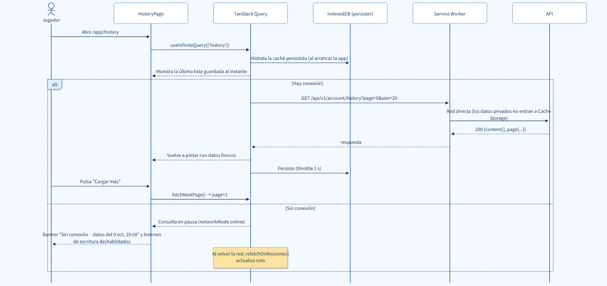

Cada lista es una consulta de TanStack Query con su clave. La caché evita pedir dos veces lo mismo y algunas consultas se guardan en IndexedDB para verse sin conexión:

| Lista | Endpoint | Clave | Pantalla | Sin conexión |
|---|---|---|---|---|
| Noticias | `GET /news` (paginada) | `['news', page]` | Landing, Noticias | Caché del SW |
| Ranuras | `GET /account/saves` | `['saves']` | Resumen, Partidas | IndexedDB |
| Historial | `GET /account/history` (paginada) | `['history', { type }]` | Historial, Resumen | IndexedDB (1.ª página) |
| Sesiones de una partida | `GET /account/sessions` (paginada) | `['sessions', { slot }]` | Detalle de partida | — |
| Logros | `GET /account/achievements` | `['achievements']` | Logros, Resumen | IndexedDB |
| Dispositivos | `GET /account/devices` | `['devices']` | Seguridad | — |

**La consulta** (paginación incremental con `useInfiniteQuery`):

```ts
// features/history/queries.ts
import { infiniteQueryOptions } from '@tanstack/react-query'
import { api } from '@/shared/api/client'
import { toProblem } from '@/shared/api/problems'
import type { components } from '@/shared/api/schema'

export type HistoryItem = components['schemas']['HistoryItem']
export type HistoryType = HistoryItem['type']

export const historyInfiniteQuery = (type?: HistoryType) =>
  infiniteQueryOptions({
    queryKey: ['history', { type }],
    queryFn: async ({ pageParam }) => {
      const { data, error } = await api.GET('/account/history', {
        params: { query: { page: pageParam, size: 20, type } },
      })
      if (error) throw toProblem(error)
      return data
    },
    initialPageParam: 0,
    getNextPageParam: (last) =>
      last.page.number + 1 < last.page.totalPages ? last.page.number + 1 : undefined,
    meta: { persist: true },
  })
```

**El renderizado** (cuatro estados en toda lista):

```tsx
// features/history/pages/HistoryPage.tsx
import { useInfiniteQuery } from '@tanstack/react-query'
import { useTranslation } from 'react-i18next'
import { Button } from '@/shared/ui/Button'
import { Skeleton, ErrorState, EmptyState } from '@/shared/ui/states'
import { historyInfiniteQuery } from '../queries'
import { useTypeFilter } from '../useTypeFilter'
import { TypeFilter } from '../components/TypeFilter'
import { Timeline } from '../components/Timeline'

export function HistoryPage() {
  const { t } = useTranslation()
  const [type, setType] = useTypeFilter()                       // synced with ?type= in the URL
  const q = useInfiniteQuery(historyInfiniteQuery(type))

  if (q.isPending) return <Skeleton rows={6} />
  if (q.isError)   return <ErrorState problem={q.error} onRetry={() => q.refetch()} />
  const items = q.data.pages.flatMap((p) => p.content)
  if (items.length === 0)
    return <EmptyState title={t('history.empty.title')} text={t('history.empty.text')} />

  return (
    <>
      <TypeFilter value={type} onChange={setType} />
      <Timeline items={items} />
      {q.hasNextPage && (
        <Button onClick={() => q.fetchNextPage()} loading={q.isFetchingNextPage}>{t('common.loadMore')}</Button>
      )}
    </>
  )
}
```

| Estado | Qué ve el jugador |
|---|---|
| Cargando | Esqueleto con la forma real de la lista (sin saltos de diseño) |
| Error | Qué pasó y un botón **Reintentar** |
| Vacía | Qué hacer para llenarla ("Juega una partida con tu cuenta iniciada y aparecerá aquí.") |
| Con datos | La lista; **Cargar más** pide la siguiente página (accesible con teclado, no atrapa el pie de página) |

Los textos viven en `shared/i18n/es.json` con claves en inglés:

```json
{
  "common": { "loadMore": "Cargar más", "retry": "Reintentar" },
  "history": { "empty": { "title": "Aún no hay actividad", "text": "Juega una partida con tu cuenta iniciada y aparecerá aquí." } },
  "errors": { "INVALID_CREDENTIALS": "Correo o contraseña incorrectos.", "USERNAME_IN_USE": "Ese nombre ya está en uso. Prueba con otro." }
}
```

---

## 8. Estrategia PWA

### 8.1 Manifiesto

Lo genera `vite-plugin-pwa`; los íconos salen de [`docs/design/icon.svg`](docs/design/icon.svg) con `@vite-pwa/assets-generator`. Se publica como `/manifest.webmanifest`:

```json
{
  "id": "/",
  "name": "The Day I Made That Promise",
  "short_name": "The Promise",
  "description": "Tu progreso, tus logros y las noticias del juego.",
  "lang": "es-MX",
  "start_url": "/app?source=pwa",
  "scope": "/",
  "display": "standalone",
  "background_color": "#F3F9FE",
  "theme_color": "#A9D6F5",
  "categories": ["games", "entertainment"],
  "icons": [
    { "src": "/pwa-192x192.png", "sizes": "192x192", "type": "image/png" },
    { "src": "/pwa-512x512.png", "sizes": "512x512", "type": "image/png" },
    { "src": "/maskable-icon-512x512.png", "sizes": "512x512", "type": "image/png", "purpose": "maskable" }
  ],
  "screenshots": [
    { "src": "/screenshots/dashboard-wide.png", "sizes": "1440x900", "type": "image/png", "form_factor": "wide", "label": "Resumen de tu cuenta" },
    { "src": "/screenshots/dashboard-mobile.png", "sizes": "780x1688", "type": "image/png", "form_factor": "narrow", "label": "Tu progreso en el teléfono" }
  ],
  "shortcuts": [
    { "name": "Historial", "url": "/app/history" },
    { "name": "Logros", "url": "/app/achievements" }
  ]
}
```

### 8.2 Qué guarda cada caché

| Recurso | Estrategia | Dónde | Expira |
|---|---|---|---|
| App shell: HTML, JS, CSS, fuentes, íconos | **Precache** con revisión por build | Cache Storage | Al activar una versión nueva |
| Navegaciones (`/`, `/app/...`) | `index.html` precacheado | Cache Storage | — |
| Imágenes | **CacheFirst** | `images` | 120 entradas / 30 días |
| Noticias y catálogo de logros (`GET`) | **StaleWhileRevalidate** | `public-api` | 50 entradas / 1 día |
| `POST /api/v1/subscriptions` sin red | **Cola de Background Sync** | IndexedDB `subscription-queue` | 24 horas |
| `/api/v1/auth/**`, `/api/v1/account/**` | El SW no los toca | — | — |

Los datos del jugador **no van a Cache Storage**, porque esa caché es del sitio, no del usuario: en una computadora compartida el siguiente vería los datos del anterior. Van a IndexedDB a través de TanStack Query, marcados con el id del jugador y borrados al cerrar sesión ([§8.5](#85-sin-conexión)).

### 8.3 Service Worker (`src/sw.ts`)

Estrategia `injectManifest`: el plugin inyecta la lista de precache y el resto es código propio.

```ts
/// <reference lib="webworker" />
import { precacheAndRoute, cleanupOutdatedCaches, createHandlerBoundToURL } from 'workbox-precaching'
import { registerRoute, NavigationRoute } from 'workbox-routing'
import { StaleWhileRevalidate, CacheFirst } from 'workbox-strategies'
import { ExpirationPlugin } from 'workbox-expiration'
import { CacheableResponsePlugin } from 'workbox-cacheable-response'
import { Queue } from 'workbox-background-sync'
import type { MessageToSW, MessageToPage } from './shared/pwa/messages'

declare const self: ServiceWorkerGlobalScope

// 1. App shell
precacheAndRoute(self.__WB_MANIFEST)
cleanupOutdatedCaches()
registerRoute(new NavigationRoute(createHandlerBoundToURL('/index.html'), { denylist: [/^\/api\//] }))

// 2. Public API: answer from cache right away and refresh in the background
registerRoute(
  ({ url, request }) => request.method === 'GET' &&
    (url.pathname.startsWith('/api/v1/news') || url.pathname === '/api/v1/achievements'),
  new StaleWhileRevalidate({
    cacheName: 'public-api',
    plugins: [new CacheableResponsePlugin({ statuses: [200] }),
              new ExpirationPlugin({ maxEntries: 50, maxAgeSeconds: 24 * 60 * 60 })],
  }),
)

// 3. Images
registerRoute(
  ({ request }) => request.destination === 'image',
  new CacheFirst({
    cacheName: 'images',
    plugins: [new ExpirationPlugin({ maxEntries: 120, maxAgeSeconds: 30 * 24 * 60 * 60 })],
  }),
)

// 4. Background: the subscription is retried on its own when the network comes back
const subscriptionQueue = new Queue('subscription-queue', {
  maxRetentionTime: 24 * 60, // minutes
  onSync: async ({ queue }) => {
    let entry
    while ((entry = await queue.shiftRequest())) {
      try { await fetch(entry.request.clone()) }
      catch (error) { await queue.unshiftRequest(entry); throw error }
    }
    const message: MessageToPage = { type: 'SUBSCRIPTION_SENT' }
    const windows = await self.clients.matchAll({ type: 'window' })
    windows.forEach((w) => w.postMessage(message))
  },
})
registerRoute(
  ({ url }) => url.pathname === '/api/v1/subscriptions',
  async ({ request }) => {
    try {
      return await fetch(request.clone())
    } catch {
      await subscriptionQueue.pushRequest({ request })
      return new Response(null, { status: 202, headers: { 'X-Queued': '1' } })
    }
  },
  'POST',
)

// 5. Update only when the user decides
self.addEventListener('message', (event: ExtendableMessageEvent) => {
  if ((event.data as MessageToSW | undefined)?.type === 'SKIP_WAITING') void self.skipWaiting()
})
```

### 8.4 Ciclo de vida y actualización

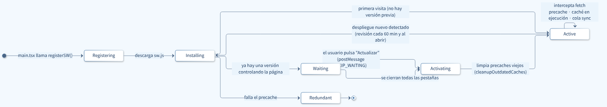

- Con `registerType: 'prompt'`, cuando hay versión nueva aparece el aviso **"Hay una versión nueva de la app. Actualizar"**; al pulsarlo la página envía `SKIP_WAITING` y se recarga.
- Se revisa si hay versión nueva al abrir la app y cada 60 minutos. Nunca se actualiza a la fuerza: el jugador podría estar llenando un formulario.

### 8.5 Sin conexión

```ts
// app/providers.tsx — TanStack Query persists selected queries in IndexedDB
<PersistQueryClientProvider
  client={queryClient}
  persistOptions={{
    persister,
    maxAge: 7 * 24 * 60 * 60 * 1000,   // 7 days
    buster: playerId ?? 'anonymous',   // another account = another cache
    dehydrateOptions: { shouldDehydrateQuery: (q) => q.meta?.persist === true && q.state.status === 'success' },
  }}>
```

- Se guardan el resumen, las partidas, la primera página del historial, los logros y la configuración (`meta: { persist: true }`).
- **Al abrir sin red:** si `refresh()` responde `OFFLINE` y hay una sesión guardada (`offlineSession`, sin tokens), la app entra en **modo lectura**: muestra lo guardado, el aviso "Sin conexión" y desactiva los botones que escriben. Al volver la red, renueva la sesión y refresca solo.
- **Al cerrar sesión o eliminar la cuenta** se borran la caché de consultas y la sesión guardada.

### 8.6 Funcionamiento en segundo plano

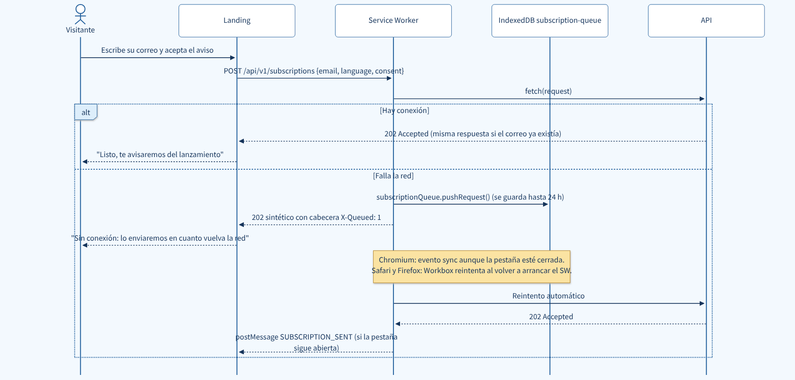

| Trabajo en segundo plano | Cómo |
|---|---|
| Enviar la suscripción hecha sin red | Background Sync (`Queue` de Workbox). En Chromium se dispara aunque la pestaña esté cerrada; en Safari y Firefox, al volver a arrancar el SW |
| Mantener noticias y logros al día | *Stale-while-revalidate*: se muestra lo guardado y se actualiza detrás |
| Descargar la versión nueva de la app | El SW nuevo se instala y precachea mientras el jugador usa la actual |
| Refrescar datos al volver | `refetchOnWindowFocus` y `refetchOnReconnect` de TanStack Query |

Solo la suscripción va a la cola porque es pública: una petición con `Authorization` se reenviaría horas después con el token ya vencido. Para lo privado, el modo lectura es más honesto que encolar cambios que podrían fallar sin avisar.

### 8.7 Instalación y verificación

- **Chrome, Edge y Android:** `InstallButton` guarda el evento `beforeinstallprompt` y muestra **"Instalar app"** en el panel y en el pie de la landing. **iOS:** el botón explica *Compartir → Agregar a inicio*. Si la app ya está instalada, el botón no aparece.
- **Lista de verificación:** manifiesto sin advertencias en DevTools; SW activo; con *Offline* marcado `/` y `/app` cargan con datos guardados; una suscripción sin red llega a la BD al volver la red; una versión nueva muestra "Actualizar"; al cerrar sesión IndexedDB queda vacío; Lighthouse ≥ 90.

---

## 9. Experiencia de usuario (UI/UX)

### 9.1 Dirección de arte: "Cielo de las islas"

La historia ocurre en islas suspendidas sobre las nubes. La interfaz es minimalista, de estética japonesa y fantasía:

- **El cielo como lienzo:** degradado de azul cielo a bruma blanca y tarjetas blancas que flotan como nubes.
- **El color cuenta la historia:** azul **Sora** (空) orienta, oro **Hikari** (光) promete (comprar, progresar), verde **Midori** (緑) confirma y el carmesí **Beni** (紅) de la espada solo marca lo irreversible y los errores.
- **Inspiración:** Sky: Children of the Light (cielo y luz dorada), sitios con elenco como Genshin Impact (sección de personajes), Ōkami (espacio vacío y acentos rojos) y landings indie como Team Cherry (una sola página con "Comprar" siempre visible).

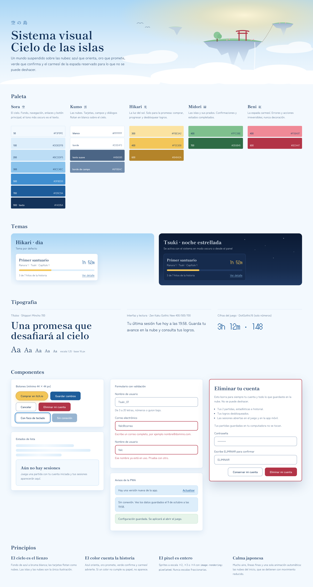

### 9.2 Estructura modular en JavaScript y CSS

**JavaScript (TypeScript):** un módulo por funcionalidad en `features/`. Cada uno publica su interfaz en `index.ts` y esconde lo demás:

```ts
// features/history/index.ts — the only thing other modules may import
export { historyRoutes } from './routes'
export { historyInfiniteQuery, type HistoryItem, type HistoryType } from './queries'
```

1. Un módulo solo importa de otro su interfaz pública: `@/features/history`, nunca `@/features/history/queries` (lo impide la regla `no-restricted-imports` de ESLint).
2. `shared/` nunca importa de `features/`.
3. Ningún componente llama a `fetch`: usa las queries de su módulo.
4. Las páginas se cargan con `lazy`, así la landing descarga lo mínimo.

**CSS:** cada componente tiene su `Name.module.css` (clases con alcance local, sin choques de nombres) y todos los valores salen de los tokens de [`docs/design/tokens.css`](docs/design/tokens.css):

```tsx
// shared/ui/Button.tsx — the props are the public interface of the component
import type { ButtonHTMLAttributes } from 'react'
import styles from './Button.module.css'

export interface ButtonProps extends ButtonHTMLAttributes<HTMLButtonElement> {
  variant?: 'primary' | 'promise' | 'outline' | 'danger'
  loading?: boolean
}

export function Button({ variant = 'primary', loading = false, disabled, className, children, ...rest }: ButtonProps) {
  return (
    <button {...rest} className={[styles.button, styles[variant], className].filter(Boolean).join(' ')}
            disabled={disabled || loading} aria-busy={loading}>
      {children}
    </button>
  )
}
```

```css
/* shared/ui/Button.module.css */
.button  { min-height: 44px; padding: 0 var(--s-5); border-radius: var(--radius-m); font: 500 var(--t-s) var(--f-body); }
.primary { background: var(--c-primary); color: var(--c-on-primary); }
.promise { background: var(--c-promise); color: var(--c-on-promise); border-radius: var(--radius-pill); box-shadow: var(--glow-promise); }
.outline { background: var(--c-surface); color: var(--c-text); border: 1px solid var(--c-control-border); }
.danger  { background: var(--c-danger); color: var(--c-on-danger); }
```

| Token | Tema Hikari · día (por defecto) | Tema Tsuki · noche | Contraste mínimo |
|---|---|---|---|
| `--c-bg` / `--c-surface` | `#F3F9FE` / `#FFFFFF` | `#0E1F3B` / `#162B4D` | — |
| `--c-text` | `#14335A` | `#EAF3FC` | 12.0 : 1 |
| `--c-text-muted` | `#4B6585` | `#A8BDD6` | 5.7 : 1 |
| `--c-primary` (botón, enlaces) | `#1D5C9A` | `#9CCBF2` | 6.5 : 1 |
| `--c-promise` (comprar, progreso) | `#F3C658` | `#F3C658` | 7.9 : 1 |
| `--c-danger` (irreversible) | `#B23447` + texto blanco | igual | 6.0 : 1 |
| `--c-error` | `#B23447` | `#F08A97` | 5.9 : 1 |
| `--c-success` | `#2E6B45` | `#7FC08E` | 6.3 : 1 |
| `--c-focus` | `#3F8ED0` | `#9CCBF2` | 3.5 : 1 |

Los contrastes se comprueban con [`docs/design/contrast.py`](docs/design/contrast.py) (WCAG 2.2 AA). El tema Tsuki se aplica con `prefers-color-scheme: dark` o desde el panel (`data-theme="tsuki"`). Tipografías autohospedadas: **Shippori Mincho** (títulos), **Zen Kaku Gothic New** (texto) y **DotGothic16** (cifras tipo HUD).

### 9.3 Diseño adaptativo

| Ancho | Landing | Panel del jugador |
|---|---|---|
| < 768 px | Una columna; botones a todo lo ancho | Navegación inferior de 5 pestañas; ranuras apiladas |
| 768–1023 px | Bucle en 2 columnas | Navegación inferior; ranuras en 2 columnas |
| ≥ 1024 px | Héroe a dos columnas; personajes lado a lado | Barra lateral fija; ranuras en 3 columnas |
| ≥ 1280 px | Contenido centrado de máximo 1200 px | Contenido de máximo 1180 px |

- *Mobile first*: el CSS base es el del teléfono y se agregan `@media (min-width: …)`.
- Unidades `rem`, títulos con `clamp()` y objetivos táctiles de al menos 44 × 44 px.
- Sprites con `image-rendering: pixelated` y solo escalas enteras (×2, ×3, ×4).
- Navegación inferior con `env(safe-area-inset-bottom)` para teléfonos con muesca.

### 9.4 Rutas y pantallas

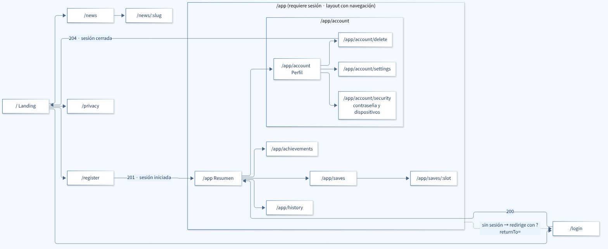

| Ruta | Pantalla | Datos | Sesión |
|---|---|---|---|
| `/` | Landing | `GET /news?size=3`, `POST /subscriptions` | No |
| `/news`, `/news/:slug` | Noticias | `GET /news`, `GET /news/{slug}` | No |
| `/register`, `/login` | Crear cuenta, iniciar sesión | `POST /auth/register`, `POST /auth/login` | No |
| `/app` | Resumen | `GET /account`, `/account/saves`, `/account/history?size=5` | Sí |
| `/app/saves`, `/app/saves/:slot` | Partidas y detalle | `GET /account/saves[/{slot}]`, `/account/sessions` | Sí |
| `/app/history` | Historial | `GET /account/history` | Sí |
| `/app/achievements` | Logros | `GET /account/achievements` | Sí |
| `/app/account/...` | Perfil, configuración, seguridad, eliminar cuenta | `/account`, `/account/settings`, `/account/devices` | Sí |

### 9.5 Accesibilidad (WCAG 2.2 AA)

- Contraste verificado; el color nunca es la única señal.
- Foco visible de 3 px, orden lógico y enlace "Saltar al contenido".
- Formularios con `<label>`, errores ligados con `aria-describedby`; avisos en `aria-live="polite"`; diálogos con `<dialog>` nativo.
- `prefers-reduced-motion` detiene las nubes animadas del héroe.
- Revisión automática con `eslint-plugin-jsx-a11y` y `cypress-axe`.

---

## 10. Seguridad y sesiones

| | Access token | Refresh token |
|---|---|---|
| Formato y vida | JWT de 15 minutos | Aleatorio, 30 días, **rota en cada uso** |
| En la PWA | Solo en memoria | Cookie `HttpOnly; Secure; SameSite=Strict` |
| En Unity / Flutter | Memoria | Almacenamiento seguro del sistema |
| En la BD | No se guarda | Solo su hash SHA-256 en `auth_sessions` |

- **Rotación con detección de reuso:** si alguien presenta un refresh token ya usado, se revoca toda su cadena y hay que volver a entrar.
- **La cuenta se crea desde la web o la app móvil y solo se elimina desde la web:** `DELETE /account` exige que el token sea del cliente `WEB` y que la contraseña se haya confirmado hace 5 minutos o menos. Al eliminar, todos los datos se borran en cascada.
- **Defensas:** contraseñas con BCrypt, límite de intentos en login y formularios públicos, CSP estricta, consultas parametrizadas y el id del jugador tomado siempre del token.

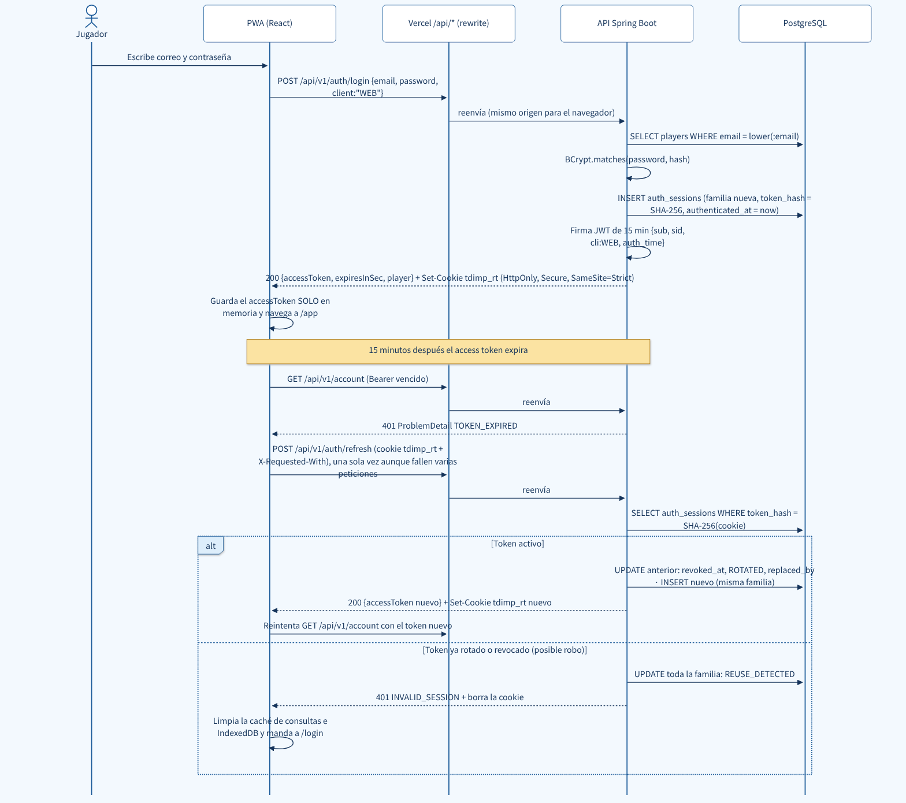

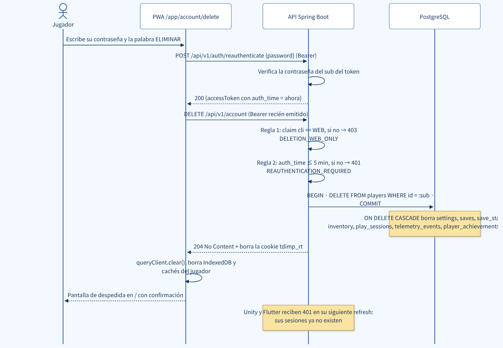

---

## 11. Calidad y despliegue

| Prueba | Backend | Frontend |
|---|---|---|
| Arquitectura | ArchUnit (§5) | ESLint `no-restricted-imports` |
| Unitarias | JUnit + Mockito con dobles de las interfaces | Vitest: cliente HTTP, esquemas y hooks |
| Integración | `@WebMvcTest` · `@DataJpaTest` contra PostgreSQL | Testing Library + MSW con los ejemplos del contrato |
| E2E | — | Cypress + `cypress-axe` contra staging |

| Entorno | PWA | API | BD |
|---|---|---|---|
| Local | `npm run dev` (Vite :5173) | `./mvnw spring-boot:run` | PostgreSQL local |
| Staging | Vercel Preview | Render | Supabase |
| Producción | Vercel Production | Render | Supabase |

GitHub Actions corre las pruebas en cada PR; un push a `dev` despliega a staging y un tag en `main` a producción. La API corre en Render con una imagen de `eclipse-temurin:21`. La configuración de Vercel vive en código (`frontend/vercel.ts`); la parte que afecta a la PWA es esta:

```ts
// frontend/vercel.ts (excerpt) — evaluated on every build
const api = process.env.API_ORIGIN                  // Preview → Render staging, Production → Render production
if (!api) throw new Error('Missing environment variable API_ORIGIN')

export const config: VercelConfig = {
  framework: 'vite',
  rewrites: [
    routes.rewrite('/api/(.*)', `${api}/api/$1`),  // proxy to Render: same origin for the browser
    routes.rewrite('/(.*)', '/index.html'),        // SPA; existing files are served first
  ],
  headers: [
    routes.header('/assets/(.*)', [{ key: 'Cache-Control', value: 'public, max-age=31536000, immutable' }]),
    routes.header('/sw.js', [{ key: 'Cache-Control', value: 'no-cache' }]),   // detect every new SW version
  ],
}
```

El plan gratuito de Render duerme la API tras 15 minutos sin tráfico; Vercel espera hasta 120 s al destino, así que la primera petición no falla y la UI muestra "Despertando el servidor".
