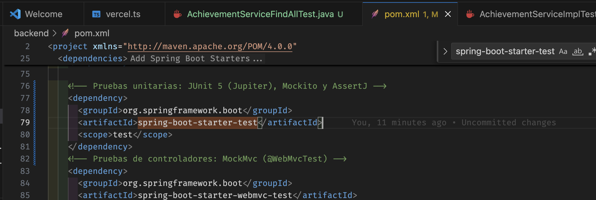
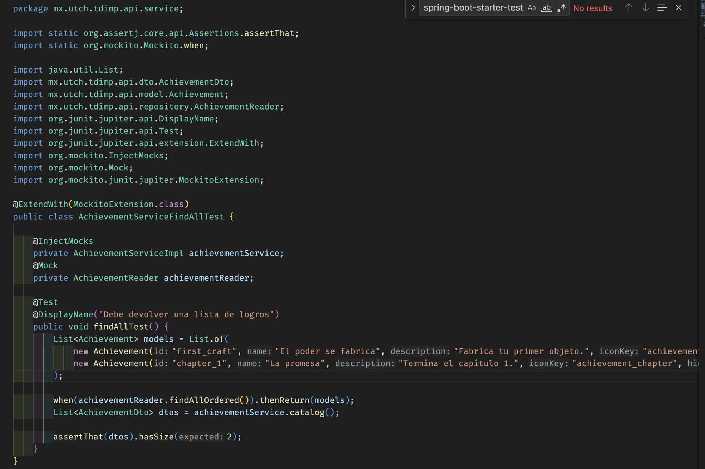
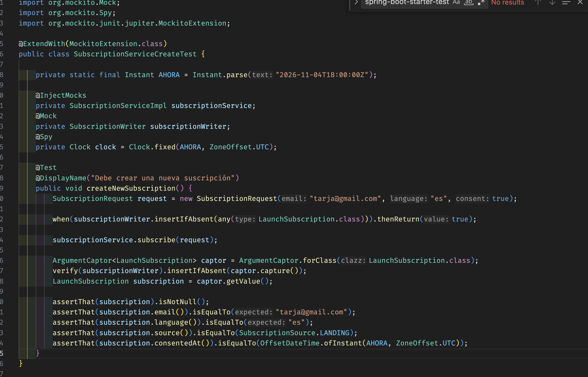
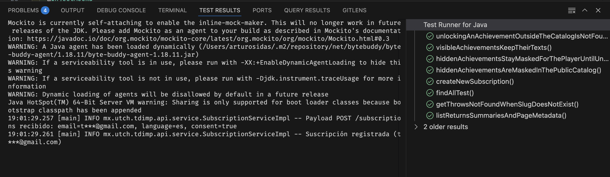
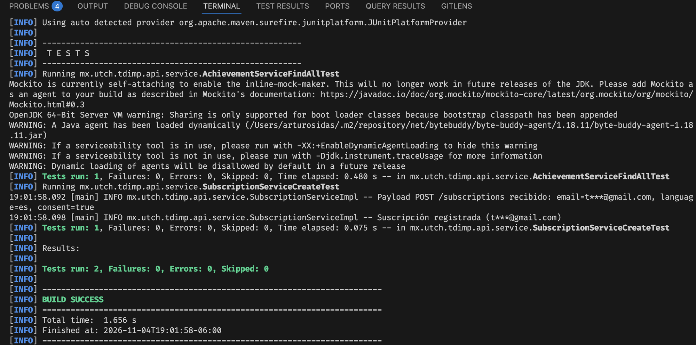

# tdimp-api

API del proyecto en Spring Boot 4.1 con Java 21. Sigue la arquitectura por capas del README principal: `controller`, `service`, `repository`, `dto` y `model`. Se conecta a la base de datos de Supabase (esquema `game`).

## Endpoints

| Método y ruta | Clases |
|---|---|
| `GET /api/v1/news?page=&size=` | `NewsController`, `NewsService`, `NewsReader` |
| `GET /api/v1/news/{slug}` | `NewsController`, `NewsService`, `NewsReader` |
| `POST /api/v1/subscriptions` | `SubscriptionController`, `SubscriptionService`, `SubscriptionWriter` |
| `POST /api/v1/auth/register` · `/login` · `/refresh` · `/logout` | `AuthController`, `AuthService`, `PlayerRepository`, `AuthSessionRepository`, `TokenIssuer`, `RefreshChannel` |
| `GET /api/v1/account` · `GET`/`PUT /account/settings` | `AccountController`, `AccountService`, `SettingsRepository`, `HistoryReader` |
| `GET /api/v1/account/sessions?slot=` · `GET /account/history?type=` | `AccountController`, `AccountService`, `HistoryReader` |
| `GET /api/v1/account/achievements` · `PUT /account/achievements/{id}` | `AccountController`, `AchievementService`, `AchievementRepository` |
| `GET /api/v1/account/saves` · `GET /account/saves/{slot}` | `SaveController`, `SaveService`, `SaveRepository` |
| `GET`/`PUT /api/v1/account/saves/{slot}/data` | `SaveController`, `SaveService`, `SaveRepository`, `CatalogReader` |
| `POST /api/v1/account/saves/{slot}/sessions` · `/events` | `SaveController`, `SaveService`, `TelemetryWriter` |
| `GET /api/v1/achievements` | `AchievementController`, `AchievementService`, `CatalogReader` |
| `GET /actuator/health` | Actuator |
| `GET /actuator/metrics/**` | Actuator, solo con el perfil `local` |

Las rutas `/api/v1/account/**` exigen `Authorization: Bearer <access token>` (`BearerAuthInterceptor`); las demás son públicas. El access token es un JWT HS256 de 15 minutos firmado con `JWT_SECRET`. El refresh token dura 30 días, rota en cada uso y en la base solo se guarda su SHA-256. Viaja en la cookie `tdimp_rt` para `WEB` y en el JSON para `UNITY_PC` y `MOBILE`.

## Variables de entorno

| Variable | Valor |
|---|---|
| `SPRING_PROFILES_ACTIVE` | `local` |
| `DB_URL` | `jdbc:postgresql://<host del session pooler>:5432/postgres?sslmode=require` |
| `DB_USER` | `postgres.<project-ref>` |
| `DB_PASSWORD` | Contraseña de la base de datos |
| `JWT_SECRET` | Cadena aleatoria de al menos 64 caracteres (obligatoria, no tiene valor por defecto) |

El host se copia de Supabase, en Connect, opción Session pooler. El archivo `.env` no se sube al repositorio.

## Ejecución

Git Bash:

```bash
cd backend
set -a; source .env; set +a
mvn spring-boot:run
```

PowerShell:

```powershell
cd backend
Get-Content .env | ForEach-Object { $k, $v = $_ -split '=', 2; Set-Item "env:$k" $v }
mvn spring-boot:run
```

En VS Code se abre la carpeta `backend` con el *Extension Pack for Java* instalado; las variables se cargan desde la terminal como se muestra arriba.

El Maven Wrapper (`mvnw`, `mvnw.cmd` y `.mvn/`) está versionado y fija Maven 3.9.11; el pipeline de CI lo usa. También se puede ejecutar con `./mvnw spring-boot:run` (Git Bash) o `.\mvnw.cmd spring-boot:run` (PowerShell) sin instalar Maven.

## Logs

Con el perfil `local` los logs se escriben en consola y en `logs/tdimp-api.log`. Por cada petición a `/api` se registra la entrada, las consultas a la base con filas afectadas y tiempo, y la salida con código de respuesta, tiempo total, tiempo en base de datos, tamaño de la respuesta y memoria heap.

## Práctica: pruebas unitarias de findAll y create

Asignatura IDGS101 · Unidad *Pruebas de Software y Calidad de Componentes* · JUnit 5 + Mockito + AssertJ.

Las pruebas validan la capa `service` de forma aislada: el repositorio es un `@Mock` de Mockito y el servicio real se construye con `@InjectMocks`, así que no se levanta Spring ni se usa la base de datos.

### Métodos probados

| Operación de la guía | Endpoint | Servicio (código fuente) | Repositorio simulado |
|---|---|---|---|
| `findAll` | `GET /api/v1/achievements` | `AchievementServiceImpl.catalog()` | `AchievementReader.findAllOrdered()` |
| `create` | `POST /api/v1/subscriptions` | `SubscriptionServiceImpl.subscribe()` | `SubscriptionWriter.insertIfAbsent()` |

### Clases de prueba

En `src/test/java/mx/utch/tdimp/api/service/` hay una clase por método. Cada una simula el repositorio con `@Mock` e inyecta el servicio real con `@InjectMocks`.

| Clase | Prueba | Qué valida |
|---|---|---|
| `AchievementServiceFindAllTest` | `findAllTest` | El repositorio simulado devuelve 2 logros y el servicio regresa una lista de 2 `AchievementDto`. |
| `SubscriptionServiceCreateTest` | `createNewSubscription` | Al suscribir `tarja@gmail.com`, el servicio guarda una sola `LaunchSubscription`. Con `ArgumentCaptor` se toma el objeto que llegó al repositorio y se verifican sus atributos: correo, idioma `es`, origen `LANDING` y la fecha del reloj fijo. |

Elementos que se usan: `@ExtendWith(MockitoExtension.class)`, `@Mock`, `@InjectMocks`, `@Spy`, `@DisplayName`, `when(...).thenReturn(...)`, `verify(...)`, `ArgumentCaptor` y `assertThat` de AssertJ en ambas pruebas.

### Dependencias

`pom.xml` incluye `spring-boot-starter-test` con `scope` `test`, que trae JUnit 5 (Jupiter), Mockito y AssertJ:

```xml
<dependency>
  <groupId>org.springframework.boot</groupId>
  <artifactId>spring-boot-starter-test</artifactId>
  <scope>test</scope>
</dependency>
```

### Ejecución

Solo las pruebas de la práctica:

```bash
cd backend
./mvnw test -Dtest='AchievementServiceFindAllTest,SubscriptionServiceCreateTest'
```

Todas las pruebas unitarias del backend (sin las de integración):

```bash
./mvnw test -Dtest='!*IntegrationTest'
```

En la terminal integrada de VS Code con PowerShell se usa `.\mvnw.cmd` con las mismas opciones. También se pueden correr desde la vista **Testing** (extensión *Extension Pack for Java*). `mvn test` sin filtro también corre las pruebas `*IntegrationTest`, que necesitan un PostgreSQL con la base `tdimp_test` (ver `application-test.yml`); sin esa base fallan al cargar el contexto de Spring, aunque las unitarias pasen.

Resultado esperado: `Tests run: 2, Failures: 0, Errors: 0, Skipped: 0` y `BUILD SUCCESS`.

### Evidencias

**1. Dependencias de prueba en `pom.xml`**



**2. Prueba de findAll (`AchievementServiceFindAllTest`)**



**3. Prueba de create (`SubscriptionServiceCreateTest`)**



**4. Ejecución en Visual Studio Code (Test Runner for Java)**



**5. Ejecución en terminal con Maven**



