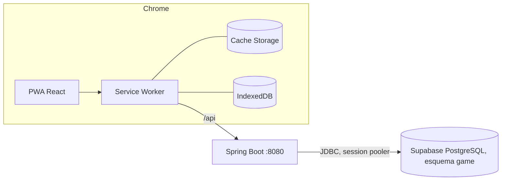

# Laboratorio de pruebas

Proyecto integrador *The Day I Made That Promise*, equipo Hex Studio (IDGS101N).

Integrantes: Jáuregui Iracheta Víctor Yahir, Medellín Salcedo Santiago, Molina Reza Omar Gael, Ramos Juárez Brenda Regina, Rodríguez González Emmanuel y Sidas Rodríguez Pedro Arturo.

## 1. Objetivo

Validar la integración de la PWA con el backend en Spring Boot y la base de datos PostgreSQL en Supabase. Se revisa que:

- las consultas `GET` se ejecuten y sus datos se muestren en la interfaz,
- los registros enviados con `POST` se guarden con la estructura y las restricciones de la tabla,
- la PWA siga funcionando sin conexión y envíe los registros pendientes cuando vuelve la red.

## 2. Alcance

Se probó el flujo público de la aplicación, que es el que tiene caché sin conexión y cola en segundo plano según la propuesta de arquitectura (README principal, secciones 8.2 y 8.6).

| Funcionalidad | Endpoint | Tabla | Comportamiento en la PWA |
|---|---|---|---|
| Listado de noticias | `GET /api/v1/news?page=&size=` | `game.news_posts` | StaleWhileRevalidate en la caché `public-api` |
| Detalle de noticia | `GET /api/v1/news/{slug}` | `game.news_posts` | StaleWhileRevalidate |
| Aviso de lanzamiento | `POST /api/v1/subscriptions` | `game.launch_subscriptions` | Cola de Background Sync en IndexedDB |

La autenticación, la cuenta del jugador, las partidas y el historial no forman parte de esta etapa.

## 3. Entorno



| Componente | Versión y configuración |
|---|---|
| Base de datos | Supabase, proyecto Hex's Project, PostgreSQL 17, región ca-central-1, esquema `game` |
| Backend | Spring Boot 4.1.1, Java 21, perfil `local`, pool HikariCP de 5 conexiones |
| Frontend | React 19, Vite 8, vite-plugin-pwa 2 (injectManifest), Workbox 7, TanStack Query 5 |
| Navegador | Google Chrome de escritorio |
| Automatización | Playwright (`frontend/scripts/lab-evidence.mjs`) |

En desarrollo la PWA reenvía `/api` a `localhost:8080` con el proxy de Vite, igual que el rewrite de Vercel en producción.

## 4. Preparación de datos

Scripts en `docs/testing/sql/`:

| Script | Uso |
|---|---|
| `00_provision_schema.sql` | Crea el esquema `game` con las migraciones V1 y V2. Ya está aplicado en Supabase. |
| `01_seed_lab.sql` | Carga el estado inicial: 12 noticias publicadas, 1 borrador y 2 suscripciones. |
| `02_reset_lab.sql` | Borra los datos generados por las pruebas. |
| `03_evidence_queries.sql` | Consultas para las capturas: A antes, B después, C integridad, D plan de ejecución. |

Antes de cada corrida se ejecuta `02_reset_lab.sql` y después `01_seed_lab.sql` en el SQL Editor de Supabase.

## 5. Ejecución

Backend (requiere `backend/.env` con la contraseña de la base):

```bash
cd backend
set -a; source .env; set +a
mvn spring-boot:run
```

PWA:

```bash
cd frontend
npm ci
npm run build
npm run preview
```

Pruebas de la API y recorrido automático:

```bash
bash docs/testing/scripts/api-smoke.sh
cd frontend && npm run lab:evidence
```

## 6. Casos de prueba

### 6.1 PWA

| ID | Caso | Resultado esperado |
|---|---|---|
| CP-01 | Carga del listado | `GET /api/v1/news?page=0&size=6` responde 200. Se muestran 6 noticias de 12. La respuesta trae `Cache-Control: public, max-age=300`. |
| CP-02 | Paginación | "Cargar más" pide `page=1` y se muestran las 12 noticias. Ambas páginas quedan en la caché `public-api`. |
| CP-03 | Registro con conexión | `POST /api/v1/subscriptions` responde 202 y se crea una fila en `launch_subscriptions`. |
| CP-04 | Listado sin conexión | Aparece el aviso de sin conexión y las noticias se cargan desde Cache Storage. |
| CP-05 | Registro sin conexión | El Service Worker responde 202 con `X-Queued: 1` y guarda la petición en IndexedDB (`workbox-background-sync`). |
| CP-06 | Regreso de la conexión | La cola se envía, queda vacía y el registro aparece en la base de datos. |
| CP-07 | Service Worker y manifiesto | El Service Worker está activo y el manifiesto no muestra errores. |

### 6.2 API y base de datos

| ID | Petición | Resultado esperado |
|---|---|---|
| API-01, API-02 | `GET /news?page=0` y `page=1`, `size=5` | 200 con `content` y `page`, `totalElements = 12` |
| API-03 | `GET /news/lab-devlog-06-forge` | 200 con el contenido de la noticia |
| API-04 | `GET /news/lab-draft-not-visible` | 404, los borradores no se publican |
| API-05 | `GET /news?size=51` | 400 `VALIDATION_FAILED` |
| API-06, API-07 | El mismo `POST` dos veces | 202 en ambos y una sola fila en la base |
| API-08 a API-11 | Correo inválido, sin consentimiento, idioma `fr`, JSON mal formado | 400 con `application/problem+json`, sin filas nuevas |
| DB-01 | Bloque C de `03_evidence_queries.sql` | Los 5 intentos inválidos son rechazados por `CHECK` o `UNIQUE` |
| DB-02 | Bloque D | La consulta usa `ix_news_posts_published` |

## 7. Evidencias

Las capturas y archivos se guardan en `docs/testing/evidencias/` con la estructura descrita en `evidencias/README.md`.

### Base de datos
- `db/db-01-antes.png`: bloque A antes de las pruebas.
- `db/db-02-despues.png`: bloque B al terminar. Aparecen los correos enviados con `id` y `created_at` generados por la base y sin duplicados.
- `db/db-03-integridad.png`: bloque C.
- `db/db-04-explain.png`: bloque D.

### Backend
- `backend/backend-01-arranque.png`: inicio con Flyway, HikariCP y Tomcat en el puerto 8080.
- `backend/backend-02-get.png`: trazas de un `GET /api/v1/news`.
- `backend/backend-03-post.png`: trazas del `POST /api/v1/subscriptions`, con el payload recibido y el `INSERT`.
- `backend/api-smoke-<fecha>.md`: resultado de `api-smoke.sh` con códigos, tiempos y métricas de Actuator.
- `backend/tdimp-api.log`: log completo de la corrida.

Cada petición a `/api` deja dos líneas en el log: la entrada y la salida, con código de respuesta, tiempo total, tiempo en base de datos, bytes de respuesta y uso de heap. El backend también envía los headers `X-Request-Id` y `Server-Timing`.

### PWA y DevTools
- `frontend/ui-01-listado.png` y `ui-02-paginado.png`: listado después del `GET`.
- `frontend/devtools-network-01-get.png`: headers del `GET`.
- `frontend/devtools-network-02-post.png`: payload y estado 202 del `POST`.
- `frontend/devtools-network-03-timing.png`: pestaña Timing con la sección Server Timing.
- `frontend/devtools-app-01-manifest.png`, `devtools-app-02-service-worker.png` y `devtools-app-03-cache-storage.png`.
- `frontend/ui-03-offline-listado.png` y `ui-04-offline-en-cola.png`: prueba sin conexión.
- `frontend/devtools-app-04-indexeddb-cola.png`: petición guardada en IndexedDB.
- `frontend/devtools-app-05-sync.png`: cola vacía después de sincronizar.
- `frontend/devtools-console-01.png` y `devtools-console-02.png`: consola durante la carga y durante la prueba sin conexión.

Con el Service Worker activo, cada petición aparece dos veces en la pestaña Network: la de la página, servida por el Service Worker, y la que el Service Worker hace a la red, marcada con un engrane. La latencia real se toma de la segunda.

### Recorrido automático
`npm run lab:evidence` repite los casos CP-01 a CP-06 y genera en `evidencias/auto/` las capturas, `network.har`, `network-report.md`, `application-report.json`, `console.log` y `summary.md`.

## 8. Observaciones

- En la primera visita la consulta se hace antes de que el Service Worker controle la página, por lo que no se guarda en caché. A partir de la segunda carga todas las peticiones a `/api` pasan por el Service Worker.
- Background Sync funciona en navegadores basados en Chromium. En Firefox y Safari la cola se envía cuando el Service Worker se reinicia.
- En Playwright, `context.setOffline()` no afecta las peticiones del Service Worker. El script las intercepta por CDP y las hace fallar con `InternetDisconnected` para simular la falta de red.
- `consented_at` guarda la hora en que la API recibe la petición. En un registro que estuvo en cola corresponde a la hora del reenvío.
- El proyecto de Supabase conserva un esquema `public` anterior que no usa la API. Las pruebas trabajan solo sobre `game`.
