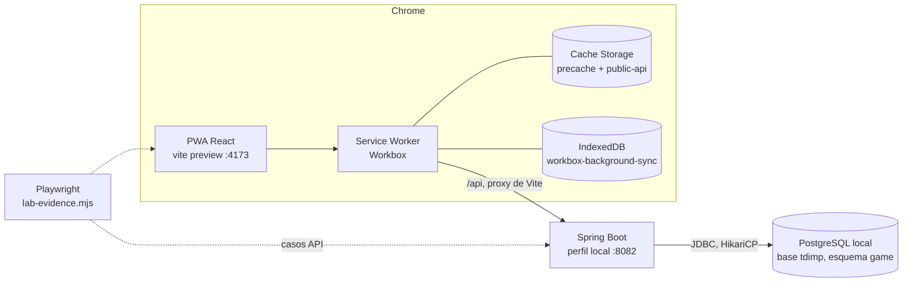

# Laboratorio de pruebas

Proyecto integrador *The Day I Made That Promise*, equipo Hex Studio (IDGS101N).

Integrantes: Jáuregui Iracheta Víctor Yahir, Medellín Salcedo Santiago, Molina Reza Omar Gael, Ramos Juárez Brenda Regina, Rodríguez González Emmanuel y Sidas Rodríguez Pedro Arturo.

## 1. Objetivo

Validar la integración de la PWA con el backend en Spring Boot y la base de datos PostgreSQL:

- que las consultas `GET` se ejecuten y sus datos se rendericen en la interfaz;
- que los envíos `POST` se guarden con la estructura y las restricciones de la tabla;
- que la PWA siga funcionando sin conexión y envíe lo pendiente cuando vuelve la red;
- que la respuesta (códigos, tiempos, tamaño, headers) sea la que define el contrato `docs/api/openapi.yaml`.

## 2. Alcance

Se prueba la parte pública de la versión final, que es la que tiene caché sin conexión y cola en segundo plano (README principal, secciones 8.2 y 8.6). La autenticación y las pantallas del jugador no forman parte de esta etapa.

| Funcionalidad | Endpoint | Tabla | Pantalla | Estrategia del Service Worker |
|---|---|---|---|---|
| Listado de noticias | `GET /api/v1/news?page=&size=` | `game.news_posts` | `/news` y sección de noticias de `/` | StaleWhileRevalidate, caché `public-api` |
| Detalle de noticia | `GET /api/v1/news/{slug}` | `game.news_posts` | `/news/:slug` | StaleWhileRevalidate, caché `public-api` |
| Catálogo de logros | `GET /api/v1/achievements` | `game.achievements` | sección de logros de `/` | StaleWhileRevalidate, caché `public-api` |
| Aviso de lanzamiento | `POST /api/v1/subscriptions` | `game.launch_subscriptions` | formulario de `/` | Cola de Background Sync en IndexedDB |

## 3. Entorno



| Componente | Versión y configuración |
|---|---|
| Base de datos | PostgreSQL local, base `tdimp`, esquema `game` creado por Flyway (V1 esquema, V2 catálogo) |
| Backend | Spring Boot 4.1.1, Java 21, perfil `local`, HikariCP de 5 conexiones, puerto 8082 (`backend/.env`) |
| Frontend | React 19, Vite 8, vite-plugin-pwa (injectManifest), Workbox 7, TanStack Query 5 |
| Navegador | Google Chrome de escritorio (capturas manuales) y Chromium de Playwright (recorrido automático) |

La PWA se sirve con `npm run preview` (build de producción, con Service Worker) y reenvía `/api` a la API con el proxy de Vite (`API_ORIGIN` en `frontend/.env.local`), igual que el rewrite de Vercel en producción.

**Trazas que se usan como evidencia**

- Backend: `RequestTraceFilter` escribe una línea al recibir cada petición (`-->`, con el tamaño del payload) y otra al responder (`<--`, con el código, tiempo total, número de consultas y tiempo en PostgreSQL, bytes de respuesta y heap de la JVM antes y después). Los repositorios registran cada consulta con sus filas y su tiempo (`BD SELECT ...`, `BD INSERT ... INSERT 0 1`). Las respuestas llevan los headers `X-Request-Id` y `Server-Timing`.
- Frontend: la consola muestra `TDIMP API` (petición, código, tiempo, tamaño), `TDIMP RENDER` (lo que se pintó) y `TDIMP PWA` / `[SW]` (Service Worker, caché y cola).

## 4. Datos del laboratorio

Scripts en `docs/testing/sql/` (pgAdmin o psql, sobre la base `tdimp`):

| Script | Uso |
|---|---|
| `01_limpieza.sql` | Borra las suscripciones y las noticias `lab-*` de corridas anteriores. Deja intacto el catálogo de V2. |
| `02_carga.sql` | Carga el estado inicial: 12 noticias publicadas (2 de V2 + 10), 1 borrador y 2 suscripciones previas. Termina verificando los conteos (y los 6 logros de V2) y **falla** si no cuadran. |
| `03_evidencias.sql` | Consultas para las capturas: A antes del envío, B después, C integridad, D plan de ejecución. |

## 5. Ejecución (PowerShell)

Tiempo aproximado: 1 hora. Se usan tres terminales y pgAdmin.

**Paso 1. Backend** (terminal 1). La primera vez crea el esquema con Flyway.

```powershell
cd backend
./mvnw spring-boot:run
```

**Paso 2. Datos** (pgAdmin, base `tdimp`, Query Tool). Ejecutar `01_limpieza.sql` y luego `02_carga.sql`; el mensaje debe decir *Estado inicial correcto*. Ejecutar el **bloque A** de `03_evidencias.sql` y tomar `db/db-01-antes.png`.

**Paso 3. PWA** (terminal 2).

```powershell
cd frontend
npm run build
npm run preview
```

**Paso 4. Recorrido automático** (terminal 3). Dura cerca de un minuto y genera todo lo marcado como *auto* en `evidencias/README.md`.

```powershell
cd frontend
npm run lab:evidence
```

Debe terminar con `API 12/12 · PWA 8/8`. Si un caso falla, deja `frontend/<caso>-ERROR.png` con la pantalla del momento.

**Paso 5. Capturas manuales en Chrome** (DevTools abierto antes de cargar la página, en `http://localhost:4173`). La primera carga instala el Service Worker; recarga una vez para que todas las peticiones pasen por él.

| Captura | Dónde | Qué debe verse |
|---|---|---|
| `devtools-01-console.png` | `/news`, pestaña **Console**, recargar | Líneas `TDIMP API → GET /api/v1/news`, `← 200 ... ms · KB`, `TDIMP RENDER NewsList renderizó 6 de 12` y los `[SW]`. |
| `devtools-02-network-get.png` | `/news`, **Network**, filtro `api`, recargar y abrir la petición `news?page=0&size=6` (la del engrane ⚙ es la que el Service Worker hizo a la red) | Columnas Status, Size y Time; en Headers: `200`, `Cache-Control: max-age=300, public`, `Server-Timing`, `X-Request-Id`. Opcional: pestaña Timing con la sección Server Timing. |
| `devtools-03-application-sw.png` | **Application › Service workers** | `sw.js` *activated and is running*. |
| `devtools-04-cache-storage.png` | **Application › Cache storage › public-api** | Las respuestas de `/api/v1/news` y `/api/v1/achievements` guardadas. |
| `devtools-05-network-post.png` | `/` (Inicio), enviar el formulario con un correo nuevo; **Network › subscriptions › Payload** | El JSON enviado y el estado `202`. |
| `devtools-06-indexeddb-cola.png` | **Application › Service workers**, marcar **Offline**; enviar otro correo (aparece *Sin conexión: guardamos tu registro…*); abrir **IndexedDB › workbox-background-sync › requests** | Una petición en `subscription-queue`. |
| `devtools-07-sincronizado.png` | Desmarcar **Offline**; en **Service workers › Sync** escribir `workbox-background-sync:subscription-queue` y pulsar **Sync**; refrescar `requests` | La PWA dice *Volvió la conexión…* y la cola quedó vacía. |

**Paso 6. Base después del envío** (pgAdmin). Ejecutar los **bloques B, C y D** de `03_evidencias.sql` y tomar `db-02-despues.png`, `db-03-integridad.png` y `db-04-explain.png`.

**Paso 7. Log del backend.** Captura de la terminal 1 con las líneas `-->` / `<--` de un `POST /api/v1/subscriptions` y un `GET /api/v1/news` → `backend/backend-01-consola.png`. El archivo completo ya lo copió el paso 4 a `backend/tdimp-api.log`.

**Paso 8. Pruebas automatizadas** (opcional, terminal 3; usan la base `tdimp_test`, así que pueden correr con la API encendida).

```powershell
cd backend;  ./mvnw verify 2>&1 | Tee-Object ../docs/testing/evidencias/backend/mvn-verify.txt; cd ..
cd frontend; npm test 2>&1 | Tee-Object ../docs/testing/evidencias/frontend/npm-test.txt; cd ..
```

## 6. Casos de prueba

Cada comportamiento se verifica una vez, en la capa donde tiene sentido; las capturas manuales documentan los mismos flujos desde DevTools y pgAdmin.

### 6.1 Base de datos

| ID | Caso | Resultado esperado | Evidencia |
|---|---|---|---|
| DB-01 | Carga del estado inicial | `02_carga.sql` termina con *Estado inicial correcto*: 12 publicadas, 1 borrador, 2 suscripciones, 6 logros. | `db-01-antes.png` |
| DB-02 | Persistencia de los envíos | Aparecen los correos `lab-api-*`, `lab-online-*` y `lab-offline-*` con `id` y `created_at` generados por la base, en minúsculas y con 0 duplicados aunque la API recibió uno de ellos dos veces. | `db-02-despues.png` |
| DB-03 | Integridad | Estructura y restricciones de la tabla; los 6 intentos inválidos (mayúsculas, sin dominio, idioma, origen, nulo, duplicado) se rechazan con `CHECK`, `NOT NULL` o `UNIQUE` y su SQLSTATE. | `db-03-integridad.png` |
| DB-04 | Plan de la consulta del listado | `Index Scan using ix_news_posts_published`. | `db-04-explain.png` |

### 6.2 API (directo a Spring Boot)

| ID | Petición | Resultado esperado |
|---|---|---|
| API-01 | `GET /news?page=0&size=6` | 200, 6 elementos, `totalElements = 12`, `Cache-Control: max-age=300, public` |
| API-02 | `GET /news?page=1&size=6` | 200, los 6 restantes |
| API-03 | `GET /news/lab-devlog-06-forge` | 200 con `contentMd` |
| API-04 | `GET /news/lab-draft-not-visible` | 404 `problem+json` `NOT_FOUND`: un borrador no se publica |
| API-05 | `GET /news?size=51` | 400 `VALIDATION_FAILED` en `size` |
| API-06 | `GET /achievements` | 200, 6 logros, los ocultos sin descripción, `Cache-Control: max-age=3600, public` |
| API-07 | `POST /subscriptions` válido | 202 |
| API-08 | El mismo correo en mayúsculas | 202 sin fila nueva (se normaliza y `ON CONFLICT DO NOTHING`); se confirma en DB-02 |
| API-09 a API-12 | Correo inválido, sin consentimiento, idioma `fr`, JSON mal formado | 400 `problem+json` `VALIDATION_FAILED` con el campo; ninguna fila nueva |
| LAT | 20 peticiones seguidas a cada `GET` | Mín, p50, p95, máx y promedio; tiempo en Spring y en PostgreSQL según `Server-Timing` |
| ACT | Actuator al terminar | Salud de la API y la base, heap usado, conexiones del pool y peticiones atendidas por URI |

Evidencia: `backend/api-report.md`, `backend/trazas.md`, `backend/tdimp-api.log`.

### 6.3 PWA (Playwright sobre las páginas reales)

| ID | Caso | Resultado esperado | Evidencia |
|---|---|---|---|
| PWA-01 | Landing `/` | Se renderizan los 6 logros (ocultos con el texto *Se revela al desbloquearlo*) y las 3 noticias recientes; el Service Worker controla la página. | `ui-01-landing.png` |
| PWA-02 | Listado `/news` | 6 de 12; *Cargar más* pide `page=1` y muestra 12. Las respuestas quedan en `public-api`. | `ui-02-noticias.png`, `application-report.json` |
| PWA-03 | Detalle `/news/:slug` | Título, fecha y Markdown de la noticia. | `ui-03-detalle.png` |
| PWA-04 | Formulario en línea | `POST` → 202 y mensaje *¡Listo!*. | `ui-04-registro-en-linea.png` |
| PWA-05 | Lectura sin conexión | Aviso *Sin conexión*; el listado y el detalle ya visitados salen de Cache Storage. | `ui-05-offline-noticias.png`, `ui-06-offline-detalle.png` |
| PWA-06 | Página no visitada sin conexión | Mensaje *No hay conexión con el servidor* y botón *Reintentar*, sin pantalla rota. | `ui-07-offline-sin-copia.png` |
| PWA-07 | Envío sin conexión | El Service Worker responde 202 con `X-Queued: 1` y guarda la petición en IndexedDB. | `ui-08-offline-en-cola.png`, `application-report.json` |
| PWA-08 | Regreso de la red | Background Sync reenvía la cola, queda vacía y la PWA avisa *Volvió la conexión*; el registro llega a la base (DB-02). | `ui-09-sincronizado.png`, `application-report.json` |

Además: `frontend/network.har` (tráfico completo de `/api`), `frontend/network-report.md` (status, si lo entregó el Service Worker, TTFB, total, bytes, payload y headers de cada petición) y `frontend/console.log` (consola de la página y del Service Worker).

## 7. Evidencias

Índice y checklist en [`evidencias/README.md`](evidencias/README.md). El resultado de la última corrida automática está en [`evidencias/resumen.md`](evidencias/resumen.md).

## 8. Observaciones

- En la primera visita la PWA consulta la API antes de que el Service Worker controle la página, así que esa respuesta no se guarda; desde la recarga todas las peticiones a `/api` pasan por él. Por eso el recorrido y las capturas recargan una vez.
- Con el Service Worker activo cada petición aparece dos veces en Network: la que recibe la página (servida por el Service Worker) y la que el Service Worker hace a la red (con ⚙). La latencia real del servidor es la segunda; el tiempo que pasa en Spring y en PostgreSQL lo da `Server-Timing`.
- `public-api` usa StaleWhileRevalidate: muestra la copia guardada al instante y la actualiza en segundo plano. Sin conexión solo están disponibles las páginas que ya se visitaron; las demás muestran el estado de error con *Reintentar*.
- Background Sync existe en navegadores Chromium. En Firefox y Safari la cola se envía cuando el Service Worker vuelve a arrancar.
- `consented_at` guarda la hora en que la API recibe la petición; en un registro que estuvo en cola es la hora del reenvío.
- En Playwright, `context.setOffline()` no corta las peticiones del Service Worker. El script se conecta al Service Worker por CDP y las hace fallar con `InternetDisconnected`, y dispara el evento `sync` para no esperar a Chrome.
- La interfaz todavía no tiene diseño (se aplica al final del proyecto); las pantallas muestran el contenido y los estados sin estilos.